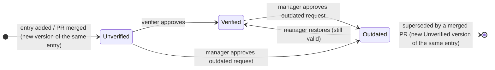
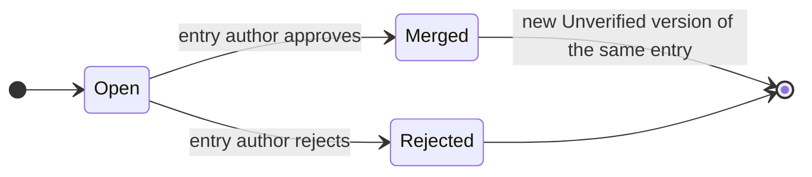

# Peerpoint — Functional Specification

*Tectonic Hackathon 2026 · SD Worx challenge · last updated 2026-10-20*

## Contents

1. [Purpose and scope](#1-purpose-and-scope)
2. [Actors and roles](#2-actors-and-roles)
3. [Key concepts and entry lifecycle](#3-key-concepts-and-entry-lifecycle)
4. [Functional requirements](#4-functional-requirements)
5. [Use cases](#5-use-cases)
6. [Business rules](#6-business-rules)
7. [Screens and notifications](#7-screens-and-notifications)
8. [Phasing and open questions](#8-phasing-and-open-questions)

---

## 1. Purpose and scope

Peerpoint is an internal knowledge database for SD Worx employees in which every entry carries human-processed feedback as trust signals. Algorithms help people find information; people decide whether it can be trusted.

Each entry stores the information itself plus four kinds of human feedback:

- **Verification** by a senior expert, team lead or manager, shown as a role badge.
- **Votes** from any employee who used the entry: a full usage record of who used it, when, where, and whether it was correct.
- **Outdated requests** when information stops being current: an employee explains why, a manager decides.
- **Contributions** through pull requests, recorded in a git-style version history.

Every entry also tells readers **whom to ask**: each author states whether the topic is their direct responsibility or something they relayed from a named source, and every person's profile lists what they are responsible for.

Information does not only arrive by someone typing it in. Bots read Teams meetings and group chats and turn what was said into **suggestions** for new entries. The people behind a statement decide what happens with their own suggestion on the **Information overview** page: **Approve** (it is added to the repository as an Unverified entry), **Reject** or **Postpone**. Their decisions stay in a history that the other participants of the meeting or chat can see. This is specified in the [AI parser specification](specs/ai-parser/FUNCTIONAL_SPEC.md).

This document defines what the system does: actors, entry lifecycle, functional requirements, use cases, business rules and screens. Architecture, stack and API are covered in the technical specification.

**PoC scope.** The hackathon proof of concept covers one category (freelance / contractor payroll), one primary role (payroll consultant) and the full loop: add → verify → search → use and cite → vote → request outdated → update via PR.

## 2. Actors and roles

Every user is an Employee; Author, Senior expert, Team lead / Manager and Admin add permissions on top. Verification authority is always scoped; "in scope" in this document means:

- **Senior expert** — entries of the departments an Admin has mapped to them.
- **Team lead / Manager** — only entries authored by members of their own team, taken from the org hierarchy. Verifying for their own team is each manager's and team lead's responsibility, so they never verify outside it, even within the same department.
- **Fallback** — if nobody is in scope for an entry (no senior expert mapped to its department and no team lead or manager in its author's team, apart from the author and the editor themselves), any Manager or Admin can verify it. As soon as someone is in scope, the fallback no longer applies.
- **Outdated requests** — decided only by managers and higher in the author's reporting line. Team leads and senior experts do not decide on them.

| Role | Who | Main responsibilities |
| --- | --- | --- |
| Employee | Every SD Worx user | Search, read, add entries, vote, request outdated, open PRs |
| Author | Creator or contributor of an entry | States their authorship basis and is listed as a contact; the creator approves PRs on their entry (their approval merges the PR) and updates outdated entries via PR |
| Senior expert | Assigned by Admin per department | Verifies entries and versions; stands in for an inactive author on PRs |
| Team lead / Manager | From the org hierarchy | Verify entries and versions for their own team only (and stand in for an inactive author on PRs for their own team); managers and higher also decide on outdated requests |
| Admin | Platform owners | Roles, department mapping, categories, tags, thresholds, teams, projects and their memberships, client companies and client projects |

### Permissions matrix

| Action | Employee | Author | Senior expert | Team lead / Manager | Admin |
| --- | --- | --- | --- | --- | --- |
| Search and read entries | Yes | Yes | Yes | Yes | Yes |
| Add an entry | Yes | Yes | Yes | Yes | Yes |
| Edit own unverified draft | Own only | Own only | Own only | Own only | No |
| Set or change own authorship basis | Own only | Own only | Own only | Own only | Own only |
| Vote on an entry | Yes, not own | Not own | Not own | Not own | Yes, not own |
| Request that an entry is marked Outdated (with reason) | Yes | Yes | Yes | Yes | Yes |
| Approve or reject an outdated request | No | No | No | Managers and higher, author's line only | No |
| Open a pull request | Yes | Yes | Yes | Yes | Yes |
| Approve and merge a PR | No | Own entries (never their own PR, unless they are the entry's author) | Only if the entry's author is inactive, mapped departments | Only if the entry's author is inactive, own team | No |
| Verify an entry version | No | Never own | Mapped departments | Own team (any Manager also by fallback) | Only by fallback, never own |
| Restore an Outdated entry (still valid) | No | No | No | Managers and higher, author's line only | No |
| View an employee profile with their teams, projects and responsibilities | Yes | Yes | Yes | Yes | Yes |
| Manage teams, projects, memberships, client companies and client projects | No | No | No | No | Yes |
| Manage roles, mapping, settings | No | No | No | No | Yes |

## 3. Key concepts and entry lifecycle

An entry's trust is always tied to one version: any change creates a new version that starts Unverified.

- **Entry** — one piece of knowledge with a permanent public ID, a scope and a department.
- **Scope** — where the information is valid, from broad to narrow: universal, EU-wide, country, company (one client company of SD Worx) or client project (one project at a client company).
- **Company / Client project** — records maintained by Admins that company- and client-project-scoped entries point to; a client project belongs to one company. A client project is not an internal Project (see below).
- **Tag** — a shared label entity (e.g. `cut-off`, `limosa`) linked many-to-many to entries; clicking a tag opens Search filtered by it.
- **Version** — a full snapshot of the entry's content and tags. Verification and votes attach here.
- **Status** — Unverified, Verified or Outdated, per version.
- **Pull request (PR)** — a proposed change to an existing entry, used for duplicates and for updating outdated information. Merging a PR adds a new version to that same entry; it never creates a second entry.
- **Outdated request** — an employee's request, with a required reason, to mark a version Outdated. It changes nothing until a manager approves it.
- **Reference** — the public ID, optionally with a version, used to cite an entry.
- **Contributor** — anyone whose text is part of the entry: the original author and every employee whose merged PR added or changed a fragment. Each fragment knows which contributors are responsible for it.
- **Employee** — a person in the SD Worx organisation, modelled as a full entity rather than a plain name. An employee has a profile (name, title, department, country, roles, reputation) and is associated with teams and projects; the profile also has a **Responsibilities** tab listing the entries they authored or co-authored. Wherever the system shows a person (author, contributor, verifier, voter), it is a link to this profile.
- **Team** — an organisational unit with a department, a lead or manager and a set of member employees. Teams come from the org hierarchy and define verification scope for team leads and managers.
- **Project** — an internal, time-bound or ongoing piece of work with a name, description, status (active, completed), a lead and a set of member employees, each with a role on the project. Projects can cut across teams and departments. A project is about who works on what; it is not a scope level and never names a client.
- **Membership** — the link between an employee and a team or project, with the employee's role there and, for projects, a start and optional end date.
- **Authorship basis** — what an author or contributor states about their link to the information:
  - **Responsible** — answering questions on this topic is part of their job; they expect to be asked and will answer.
  - **Relayed** — they read or heard the information and added it; they must name the **source** (document, link, regulation, newsletter, colleague).
- **Contacts** — the authors and contributors of an entry as shown to readers, with their basis: the people to ask about it, responsible ones first.
- **Access token** — a short-lived signed JWT that identifies the signed-in employee and carries their roles; sent with every request.
- **Refresh token** — a longer-lived, revocable token used to obtain new access tokens without signing in again.

### Entry version lifecycle

### Pull request lifecycle

Only the entry author decides on a PR. The merged version is Unverified and then goes through normal verification like any other new version. If the entry's author is no longer active, a verifier in scope decides in their place. A PR opened by the entry author themselves merges immediately.

A version becomes Verified only through a verifier. It becomes Outdated only when a manager approves an outdated request; it then ranks lower until a manager restores it or a merged PR supersedes it with a new, Unverified version of the same entry. Votes can be added in any status and belong to one version.

## 4. Functional requirements

Requirements are grouped by module. Phase marks what the hackathon PoC delivers (MVP) and what follows (Phase 2).

### Entries

| ID | Requirement | Phase |
| --- | --- | --- |
| FR-E1 | An employee can add an entry with title, content, justification (source or reasoning) and category. | MVP |
| FR-E2 | Every entry has tags: country, date, author, department, role, keywords. | MVP |
| FR-E3 | Every entry has a scope: country-specific, EU-wide (union) or universal. | MVP |
| FR-E4 | Every entry gets a permanent unique public ID on creation that never changes. | MVP |
| FR-E5 | A new entry is always saved as Unverified. | MVP |
| FR-E6 | Entries are shown in the reader's language first when a translation exists. | Phase 2 |
| FR-E7 | An entry can also have a narrower scope: company-specific (one client company) or client-project-specific (one project at a client company). These scopes point to a company or client-project record (BR-11). | Phase 2 |

### Verification

| ID | Requirement | Phase |
| --- | --- | --- |
| FR-V1 | Senior experts, team leads and managers have an approval tab listing unverified versions in their scope. | MVP |
| FR-V2 | A verifier can approve a version; it becomes Verified with a role badge (Senior Expert, Team Lead, Manager). | MVP |
| FR-V3 | A verifier can send a version back to the author with a comment. | MVP |
| FR-V4 | Admins maintain the mapping of which senior experts may verify which departments. Team leads and managers verify only entries of their own team, based on the org hierarchy. If nobody is in scope for an entry, any Manager or Admin can verify it (fallback). Only the current version of an entry is queued for verification. | MVP |
| FR-V5 | Verification attaches to a version, not to the entry. A new version starts Unverified. | MVP |
| FR-V6 | Unverified entries show who to ask: the author and verifiers of that department (see the Contacts block, FR-K3). | MVP |

### Voting (peer review)

| ID | Requirement | Phase |
| --- | --- | --- |
| FR-P1 | Any employee can vote on an entry version by submitting a usage record: **used by** (filled in automatically), **when** (date of use), **where** (the case, process or document it was applied in) and **was it correct** (yes / no). All fields are required. | MVP |
| FR-P2 | One vote per user per version; users cannot vote on entries they authored or contributed to. | MVP |
| FR-P3 | Correct and incorrect votes are counted and shown separately as badges; they never replace verification. | MVP |
| FR-P4 | A user can edit or withdraw their own vote. | MVP |
| FR-P5 | The entry page lists all usage records of the current version: who, when, where, correct or not. | MVP |
| FR-P6 | An "incorrect" vote notifies the author and the last verifier. | MVP |

### Search

| ID | Requirement | Phase |
| --- | --- | --- |
| FR-S1 | One search bar across all categories. | MVP |
| FR-S2 | Results are ranked by relevance × trust weight (see [BR-1](#br-1-search-ranking)). | MVP |
| FR-S3 | Each result shows status and role badge, correct / incorrect vote counts, country, date and author. | MVP |
| FR-S4 | Unverified entries appear in search right after they are saved, with an **Unverified** tag; Outdated entries carry an **Outdated** tag. Both rank lower but are never hidden. | MVP |
| FR-S5 | The search bar on the main page has a filter panel. Available filters: country, department, category, status (Unverified, Verified, Outdated), scope (country-specific, EU-wide, universal, company, client project), verifier role, author, team (entries authored by members of the team), company (entries scoped to that company or to one of its client projects), client project (entries scoped to that client project), tags (FR-T4) and last-updated date range. Internal projects are not a search filter. | Phase 2 |
| FR-S6 | Filters combine with AND across different filters; within one filter, several selected values combine with OR. | Phase 2 |
| FR-S7 | Filters narrow the result set only; the remaining results keep the ranking of [BR-1](#br-1-search-ranking). No filter is applied by default; the searcher's country influences ranking, not filtering. | Phase 2 |
| FR-S8 | Active filters are shown as removable chips next to the search bar, with a "clear all" action and the number of matching results. | Phase 2 |
| FR-S9 | The query and active filters are reflected in the page URL, so a filtered search can be bookmarked, shared and restored with the back button. | Phase 2 |
| FR-S10 | Filters can be used without a text query, to browse entries by filter alone. | Phase 2 |
| FR-S11 | Each result also shows its scope, with the company or client project, and its tags, which are clickable (FR-T3). | Phase 2 |

### Tags

| ID | Requirement | Phase |
| --- | --- | --- |
| FR-T1 | Tags are shared entities with a unique, normalized name (lowercase, trimmed) and a type: **keyword** (set by people) or **automatic** (country, date, author, department, role — set by the system). A tag can be linked to many entries, and an entry to many tags. | Phase 2 |
| FR-T2 | While the user types a tag, existing tags are suggested; a new tag is created only when none matches. | Phase 2 |
| FR-T3 | Every tag shown in the app — on the entry page, in search results, in the approval tab, on profiles — is clickable and opens the Search page with that tag pre-filled as a filter. The tag is part of the URL (FR-S9, e.g. `/search?tag=cut-off`), so the link can be shared. | Phase 2 |
| FR-T4 | Search can filter by one or several tags (FR-S5), combined with the text query and the other filters. | Phase 2 |
| FR-T5 | Admins can rename and merge tags; all links to entries are kept. | Phase 2 |

### Citing

| ID | Requirement | Phase |
| --- | --- | --- |
| FR-C1 | Each entry has a copy-able reference (public ID, optionally with version). | MVP |
| FR-C2 | A reference to an old version shows that a newer version exists. | MVP |
| FR-C3 | The entry page shows where it has been cited, when citations are registered in the system. | Phase 2 |

### Duplicate detection and pull requests

| ID | Requirement | Phase |
| --- | --- | --- |
| FR-D1 | While an entry is written and on submit, it is compared with existing entries for similarity. | MVP (keyword), Phase 2 (embeddings) |
| FR-D2 | Above the similarity threshold, the user sees an advisory warning with the similar entries and a "Create pull request" option. The warning never blocks saving. | MVP |
| FR-D3 | The user can still save the entry after the warning. It follows the standard flow: saved as Unverified, published and findable in search immediately, then verified by a verifier in scope. The user can optionally add a "why is this different?" note, which is stored on the entry and shown to verifiers in the approval tab. | MVP |
| FR-D4 | Any employee can open a PR on an existing entry via "Suggest change", with proposed content and a change note. | Phase 2 |
| FR-D5 | A PR is approved by the original author of the entry. No verifier approval is needed to merge. If the author is no longer active, a verifier in scope approves in their place. A PR opened by the entry author themselves is approved implicitly and merges immediately. Nobody approves or rejects their own PR otherwise. | Phase 2 |
| FR-D6 | The approver can reject a PR with a reason; the reason is required. | Phase 2 |
| FR-D7 | On approval the PR is merged into the existing entry: it adds one new version to that entry, which is Unverified and then follows the standard verification flow. The entry keeps its public ID; no second entry is created. | Phase 2 |
| FR-D8 | After a merge the entry appears once everywhere (search, lists, references), showing the merged version as its current version. The previous version is not a separate entry or search result; it stays available only in the entry's history and through references to it. | Phase 2 |

### Outdated entries

| ID | Requirement | Phase |
| --- | --- | --- |
| FR-O1 | Any employee can submit an outdated request on an entry. A reason explaining why it is outdated is required. | MVP |
| FR-O2 | The request goes to the approval tab of managers and higher in the author's reporting line; team leads and senior experts cannot decide on it. | MVP |
| FR-O3 | The manager approves the request, which marks the version Outdated, or rejects it with a comment; the requester and author are notified either way. | MVP |
| FR-O4 | While a request is pending, the entry keeps its status and ranking and shows an "outdated request pending" notice. | MVP |
| FR-O5 | Entries not updated for a configurable period show a "may be outdated" hint; this is a hint only and does not change the status. | MVP |
| FR-O6 | Outdated entries get a warning badge showing the approved reason, and a lower ranking. | MVP |
| FR-O7 | An Outdated entry is resolved by a merged PR, or by a manager restoring it as still valid. | MVP (restore), Phase 2 (PR) |

### Version history and contributors

Every piece of information shows who stands behind each part of it, so a reader always knows whom to ask.

| ID | Requirement | Phase |
| --- | --- | --- |
| FR-H1 | Every version is stored as a full snapshot with author, date and change note. | MVP |
| FR-H2 | Every entry shows a list of all its contributors, with name, role and reputation. | Phase 2 |
| FR-H3 | When a user selects a line or fragment of the text, the contributors responsible for it are shown next to that line, with a way to contact them. | Phase 2 |
| FR-H4 | Clicking a contributor in the list highlights all text in the current version that this contributor is responsible for. | Phase 2 |
| FR-H5 | At the bottom of the entry page, a git-style log lists all changes: version, author, date and change note, newest first. | Phase 2 |
| FR-H6 | Clicking a log item shows a diff of that change: which text fragments it added, edited or removed, and by whom. | Phase 2 |
| FR-H7 | History is append-only; no user can delete or rewrite past versions. | MVP |
| FR-H8 | Every diff, wherever it is shown (change log, approval tab for pending PRs), has a header naming the author of the change, the date, the change note and the two versions compared. For a merged change it also names the approvers. Each added, edited or removed fragment is attributed to its author, and the author's name links to their profile. | Phase 2 |

### Contacts and profiles

Authorship tells future readers whom they can contact about a topic, and on what basis.

| ID | Requirement | Phase |
| --- | --- | --- |
| FR-K1 | When adding an entry, the author states their authorship basis: **Responsible** or **Relayed**. Relayed requires a source, which also prefills the justification. | Phase 2 |
| FR-K2 | An author can change their own basis and source at any time, e.g. after a change of role. The change is recorded in the change log and does not create a new version or reset verification. | Phase 2 |
| FR-K3 | The entry page shows a **Contacts** block with all authors and contributors: responsible ones first, labelled "Responsible for this topic", then relayed ones, labelled "Added from source" with the source. | Phase 2 |
| FR-K4 | Each contact shows name, title, department and reputation, links to their profile and has a contact action (Teams chat or e-mail). | Phase 2 |
| FR-K5 | Users who left the company are not shown as contacts. If no active responsible person remains, the block says "No responsible contact" and lists the verifiers in scope (FR-V6). | Phase 2 |
| FR-K6 | Verifiers see each author's basis and source in the approval tab. | Phase 2 |
| FR-K7 | The Responsibilities tab is part of the employee profile (FR-U4); every author and contributor name links to that profile (FR-U3). | Phase 2 |
| FR-K8 | The person's entries on the profile (FR-U6) are shown in a **Responsibilities** tab: every entry the person authored or co-authored, in two groups: **Responsible** — their responsibilities — and **Relayed**, with the source they named. Each item shows title, public ID, status badge and whether the person is author or co-author. | Phase 2 |
| FR-K9 | The tab opens with the person's **areas of responsibility**: the categories, scopes (countries, companies, client projects) and tags of the entries where they are Responsible. | Phase 2 |
| FR-K10 | On their own profile, a user can change their basis for one or several listed entries at once, e.g. to hand over responsibility after moving to another team. | Phase 2 |
| FR-K11 | A PR author states a basis for their change when opening the PR and becomes a contact with it once the PR is merged. | Phase 2 |
| FR-K12 | Search results show a "Responsible contact" marker on entries with at least one active responsible person. | Phase 2 |
| FR-K13 | Responsible people are asked once a year to reconfirm each of their responsibilities; without an answer they are shown as Relayed. | Phase 2 |

### Reputation

| ID | Requirement | Phase |
| --- | --- | --- |
| FR-R1 | Users earn reputation when their entries are verified, voted on and cited, and when their PRs are merged. | MVP |
| FR-R2 | Reputation is shown on profiles and next to author names. | MVP |
| FR-R3 | Admins can see reputation per department to spot senior-expert candidates. | Phase 2 |

### Notifications

| ID | Requirement | Phase |
| --- | --- | --- |
| FR-N1 | In-app notifications for: new entry in scope, PR opened, approval needed, outdated request submitted or decided, entry verified, incorrect vote reported. | MVP |
| FR-N2 | E-mail notifications and scheduled reminders for pending approvals. | Phase 2 |
| FR-N3 | Teams / Slack notifications. | Phase 2 |

### People, teams and projects

An employee is not just a name in an entry: it is an entity that connects the entry to the people, teams and projects behind it, so a reader can see where someone works and who to approach.

| ID | Requirement | Phase |
| --- | --- | --- |
| FR-U1 | Employee, Team and Project are first-class entities. An employee has name, e-mail, title, department, country, roles and reputation. A team has name, department, lead or manager and members. A project has name, description, status, lead and members. | Phase 2 |
| FR-U2 | An employee can belong to several teams and several projects. Each membership records the employee's role in that team or project; project memberships also record a start date and optional end date. | Phase 2 |
| FR-U3 | On the entry page, every person shown (author, contributors, verifiers, "who to ask", and users in usage records) is a link. Clicking it opens that employee's profile page. | Phase 2 |
| FR-U4 | The employee profile page shows the person's details (name, title, department, country, role badges, reputation) and lists **all teams and all projects** they are associated with, with their role in each and, for projects, the period and status. | Phase 2 |
| FR-U5 | Current and past project memberships are both shown; past ones are marked as ended. | Phase 2 |
| FR-U6 | The profile page also lists the person's entries, so a reader can see what else they have written. | Phase 2 |
| FR-U7 | Teams and projects have a detail page listing their members; each member links to their profile. Team and project names on a profile link to these pages. | Phase 2 |
| FR-U8 | Admins create and edit teams, projects and memberships. The team structure remains the source for verification scope (see [BR-6](#br-6-anti-gaming-and-integrity)). | Phase 2 |

### Authentication and authorization

The PoC uses a demo user picker. Phase 2 replaces it with real sign-in based on an OAuth2-style flow and JWTs.

| ID | Requirement | Phase |
| --- | --- | --- |
| FR-A1 | Users sign in through the OAuth2 authorization code flow with PKCE against the SD Worx identity provider (OpenID Connect compatible). Peerpoint never sees or stores passwords. | Phase 2 |
| FR-A2 | After a successful sign-in Peerpoint issues a short-lived access token (JWT, default 15 minutes) and a refresh token (default 8 hours). The frontend sends the access token as a bearer token on every API request. | Phase 2 |
| FR-A3 | The access token is signed with an asymmetric key and carries the employee ID, roles, issuer, audience, issue time and expiry. Every request validates signature, expiry, issuer and audience. | Phase 2 |
| FR-A4 | Refresh tokens are rotated on every use and can be revoked. Signing out revokes the refresh token. When an access token expires, the frontend renews it silently; if renewal fails, the user is sent to sign in again. | Phase 2 |
| FR-A5 | Authorization is enforced server-side on every endpoint. Roles in the token grant coarse access (for example admin screens); scoped authority (department mapping for senior experts, own team for team leads and managers, author's reporting line for outdated decisions) is checked against current data and never trusted from the token alone. | Phase 2 |
| FR-A6 | A request without a valid token receives 401; a valid token without sufficient permission receives 403. Neither response reveals whether a protected entry or resource exists beyond what the user may see. | Phase 2 |
| FR-A7 | On first sign-in the identity from the provider is matched to an existing Employee by company e-mail or employee ID. Unknown or inactive employees are denied. | Phase 2 |
| FR-A8 | Role changes made by an Admin take effect at the latest when the current access token expires; Admins can force sign-out by revoking an employee's refresh tokens. | Phase 2 |
| FR-A9 | The demo user picker stays available only in development and demo mode and is disabled by configuration in any other environment. | Phase 2 |
| FR-A10 | Sign-in, token refresh, sign-out and denied requests are written to the append-only audit log. | Phase 2 |

## 5. Use cases

Ten use cases cover the demo storyline end to end. UC-1 to UC-5 are MVP; UC-6 (pull requests), UC-7 (contributors), UC-8 (employee profiles), UC-9 (sign-in) and UC-10 (responsibilities) depend on Phase 2 requirements and are Phase 2. UC-1 and UC-3 also have Phase 2 acceptance criteria.

### UC-1 Add an entry

**Actor:** Employee A · **Covers:** FR-E1–E5, FR-D1–D3, FR-K1, FR-N1

1. A opens "Add entry", fills in title, content, justification, category and tags. (Phase 2: A also states whether the topic is A's responsibility or relayed from a source.)
2. While A types, the system checks similarity with existing entries.
3. No similar entry: A submits; the entry is saved as Unverified with a new public ID.
4. Verifiers in scope are notified.

**Alternative:** a similar entry exists → the system shows an advisory warning. A either opens a PR on the similar entry (see [UC-6](#uc-6-handle-a-duplicate-or-change-via-pull-request)), or saves the entry anyway. Saving anyway follows the standard flow (steps 3–4): Unverified, then verifier approval. A may add an optional "why is this different?" note, which verifiers see when reviewing.

**Acceptance criteria**

- [ ] The new entry has status Unverified and a unique public ID.
- [ ] The entry is findable in search immediately, tagged Unverified.
- [ ] Required fields (title, content, category, country) are validated before save.
- [ ] (Phase 2) A company or client-project scope requires choosing the company or client project.
- [ ] (Phase 2) An entry cannot be saved without an authorship basis, and a Relayed basis needs a source.
- [ ] The entry appears in the approval tab of every verifier in scope, and nowhere else as pending.
- [ ] The duplicate warning is advisory: saving despite a warning follows the same rules as any other new entry (Unverified, published immediately, verifier approval).
- [ ] An optional "why is this different?" note is stored on the entry and shown to verifiers in the approval tab.

### UC-2 Verify an entry

**Actor:** Senior expert, Team lead or Manager · **Covers:** FR-V1–V5

1. The verifier opens the approval tab and selects a pending version.
2. They review content, justification and tags.
3. They approve, or send it back with a comment.

**Acceptance criteria**

- [ ] On approval, the version becomes Verified and shows the verifier's role badge.
- [ ] A verifier cannot verify their own entry or an entry outside their scope (enforced server-side).
- [ ] The author is notified of the outcome.

### UC-3 Search and use an entry

**Actor:** Employee B · **Covers:** FR-S1–S11, FR-T3–T4, FR-C1–C2

1. B types a question in the search bar, optionally narrowing it with filters (for example country, status, team or client project), or clicks a tag on an entry to see everything with that tag.
2. The system returns ranked results with badges.
3. B opens an entry, reads it and copies its reference to cite in their work.

**Acceptance criteria**

- [ ] Verified entries for B's country rank above unverified ones with similar relevance.
- [ ] Unverified entries are shown in the results with a visible Unverified tag.
- [ ] Every result shows status, role badge, correct / incorrect vote counts, country, date and author.
- [ ] The copied reference contains the public ID and version.
- [ ] (Phase 2) Selecting filters narrows the results to entries matching all active filters; several values of one filter match any of them.
- [ ] (Phase 2) Active filters appear as removable chips; "clear all" restores the unfiltered result list.
- [ ] (Phase 2) Filtering does not change the relative order of the remaining results.
- [ ] (Phase 2) Reloading the page or sharing the URL reproduces the same query and filters.
- [ ] (Phase 2) Clicking a tag opens Search with that tag pre-filled, and the resulting URL can be shared.

### UC-4 Vote on an entry

**Actor:** Employee B · **Covers:** FR-P1–P6, FR-R1

1. After using the entry, B clicks "Report usage".
2. B's name is filled in automatically; B enters when the entry was used, where (e.g. the case or process reference) and whether it was correct.
3. The usage record appears on the entry page and the matching counter increases.
4. A correct vote updates the author's reputation; an incorrect vote notifies the author and the last verifier.

**Acceptance criteria**

- [ ] A vote without date, context or outcome is rejected.
- [ ] The "where" field holds a reference to the case or process, not confidential customer data.
- [ ] A second vote by the same user on the same version is rejected; the user can edit their existing one instead.
- [ ] Authors and contributors cannot vote on their own entry.
- [ ] A vote attaches to the current version only.

### UC-5 Request that an entry is marked Outdated

**Actor:** Employee B, then a manager of the author's reporting line · **Covers:** FR-O1–O7

1. B notices the rule has changed and clicks "Request outdated", entering why the entry is outdated.
2. The request appears in the approval tab of the author's manager and higher; the entry shows an "outdated request pending" notice.
3. The manager reviews the reason and approves or rejects the request with a comment.
4. On approval, the entry gets an Outdated badge with the reason and drops in ranking. B and the author are notified.
5. The author or B opens a PR with the new information (UC-6), or later a manager restores the entry as still valid.

**Acceptance criteria**

- [ ] A request without a reason cannot be submitted.
- [ ] Only managers and higher in the author's reporting line can decide; team leads, senior experts and the requester cannot (enforced server-side).
- [ ] A pending request does not change the entry's status or ranking.
- [ ] The decision, the manager who made it and the reason are recorded in the change log.

### UC-6 Handle a duplicate or change via pull request

**Actor:** Employee C, author, verifier · **Covers:** FR-D2–D7, FR-H1

1. C writes an entry similar to A's; the system shows a warning with A's entry.
2. C chooses "Create pull request" and adds the new information to A's entry.
3. A approves the PR; no verifier approval is needed.
4. The PR is merged into A's entry as a new version, which is Unverified like any new entry. Verifiers in scope are notified and verify it through the normal approval tab.

**Acceptance criteria**

- [ ] Only the entry author (or, if the author is inactive, a verifier in scope) can approve or reject the PR; the PR author cannot approve their own PR.
- [ ] The author's approval merges the PR; no verifier approval is required.
- [ ] After the merge there is still exactly one entry with the original public ID; no second entry is created.
- [ ] Search and lists show that entry once, with the merged version as its current version and an Unverified tag.
- [ ] The previous version is not shown as a separate result; it remains in history and old references still resolve and show that a newer version exists. A superseded Unverified version no longer appears in the approval tab.
- [ ] C is recorded as contributor of the fragment they added.
- [ ] The diff shown to the approvers states who authored the change (C), when, and the change note.

### UC-7 Find whom to ask about a fragment

**Actor:** Employee B · **Covers:** FR-H2–H6

1. B reads an entry and has a question about one line.
2. B selects the line; the contributors responsible for it appear next to it.
3. B contacts one of them directly from there.
4. To understand how the line came to be, B opens the change log at the bottom of the page and clicks the change that introduced it, which shows the fragment and its author.
5. To see everything one colleague wrote, B clicks that contributor in the list; their text is highlighted.

**Acceptance criteria**

- [ ] Every line of the current version maps to at least one contributor.
- [ ] Selecting a line shows only the contributors responsible for that line, not all contributors of the entry.
- [ ] Clicking a log item shows exactly the fragments changed in that version, with the author of the change.
- [ ] Every diff header shows the author, date, change note and the versions compared; a merged change also shows who approved it.
- [ ] Clicking a contributor highlights all their text, and clicking again removes the highlight.

### UC-8 Look up a colleague's teams and projects

**Actor:** Employee B · **Covers:** FR-U1–U7, FR-H2

1. B reads an entry and wants to know more about its author.
2. B clicks the author's name on the entry page.
3. The system opens the author's profile page: details, role badges, reputation, and all teams and projects they are associated with, with their role in each.
4. B clicks a project to see who else works on it, then opens another member's profile from there.

**Acceptance criteria**

- [ ] Every person shown on the entry page (author, contributors, verifiers, who to ask, voters) links to their profile.
- [ ] The profile lists every team and every project the employee is a member of, with their role; ended project memberships are marked as ended.
- [ ] Team and project names link to a page listing their members, and each member links back to a profile.
- [ ] The profile lists the employee's entries.
- [ ] An employee without any team or project membership shows an empty state, not an error.

### UC-9 Sign in and use the application securely

**Actor:** Any employee, Admin · **Covers:** FR-A1–A10

1. An unauthenticated user opens Peerpoint and is sent to sign in with the SD Worx identity provider.
2. After signing in, the user is returned to Peerpoint and receives an access token and a refresh token.
3. Every API call carries the access token; when it expires, the frontend renews it silently with the refresh token.
4. The user signs out; the refresh token is revoked and protected screens are no longer reachable.
5. An employee without the required role (for example, a non-admin opening the admin panel) receives a clear "not allowed" response.

**Acceptance criteria**

- [ ] Peerpoint never receives or stores the user's password.
- [ ] A request without a valid, unexpired token is rejected with 401; a request with a valid token but insufficient permission is rejected with 403.
- [ ] Verification, outdated decisions and PR approvals are rejected server-side when outside the user's scope, even if the token's roles would otherwise allow the action.
- [ ] A used refresh token cannot be used again; after sign-out the old refresh token is rejected.
- [ ] Sign-in from an unknown or inactive employee is denied.
- [ ] Sign-in, refresh, sign-out and denied requests appear in the audit log.
- [ ] The demo user picker is unavailable when demo mode is disabled.

### UC-10 See whom to ask and what they are responsible for

**Actors:** Employee B, Employee A · **Covers:** FR-K2–K10, FR-U4

1. B reads an entry; its Contacts block shows A as "Responsible for this topic" and C as "Added from source", with C's source.
2. B opens A's employee profile; its Responsibilities tab shows A's areas of responsibility, the entries A is responsible for, then those A relayed.
3. B contacts A through Teams from the profile.
4. Later A moves to another team and, on their own Responsibilities tab, switches several entries to Relayed, naming the team handbook as source.

**Acceptance criteria**

- [ ] Responsible people are listed before relayed ones, on the entry and on the profile.
- [ ] Every relayed item shows its source.
- [ ] People who left the company are not shown as contacts; an entry with no responsible person left shows "No responsible contact" and the verifiers in scope.
- [ ] The Responsibilities tab shows a viewer only entries they could find in search.
- [ ] Changing a basis is recorded in the change log and creates no new version.

## 6. Business rules

All thresholds and weights below are configurable by Admins; the values given are PoC defaults.

### BR-1 Search ranking

`score = text relevance × trust weight`

The trust weight combines, in order of importance:

1. Verification status and verifier's role level (Manager, Team lead, Senior expert, then Unverified).
2. Votes on the current version: correct votes raise the weight, incorrect votes lower it. A vote from a Senior expert counts 1.3× (30 % more) than a vote from other employees.
3. Scope match: the searcher's country first, unless the entry is universal or EU-wide. Company- and client-project-scoped entries rank first when the search is filtered by that company or client project, and below broader entries otherwise.
4. Freshness: Outdated entries drop in ranking; recency is a minor factor.
5. Author reputation, as a tie-breaker.

Unverified and Outdated entries are never hidden: they are shown with their tag and ranked lower.

### BR-2 Duplicates

- Similarity is checked against the current versions of all entries in the same language.
- Default warning threshold: 60 % similarity.
- The warning is advisory and never blocks saving. If the user saves anyway, the standard rules apply: the entry is saved as Unverified, is published and findable immediately, and goes to verifiers in scope. It does not wait for approval from the author of the similar entry.
- The user may add an optional "why is this different?" note. It is stored on the entry and shown to verifiers, so they have context when deciding whether the entry is a duplicate.

### BR-3 Versions and verification

- Verification and votes belong to one version. A merged PR adds a new version to the same entry, with status Unverified and zero votes; it never creates a second entry.
- An entry is listed once. Search, lists and the entry page always show its current version; earlier versions appear only in the history.
- The previous version's verification and votes stay visible in history.
- References to older versions resolve and show that a newer version exists.

### BR-4 Outdated

- Marking an entry Outdated is always a request: any employee can submit one, a reason is required.
- Only managers and higher in the author's reporting line decide whether the request is correct. Nobody can approve their own request.
- One open request per entry version; further employees can add their reason to the existing request.
- Default "may be outdated" hint: no update for 12 months. The hint never changes the status.
- An Outdated entry leaves that status only through a merged PR or a manager restoring it.

### BR-5 Reputation

| Event | Points to |
| --- | --- |
| Entry version verified | Author |
| Correct vote received | Author (and contributors of that version) |
| PR merged | PR author |
| Entry cited | Author |

Point values are set by Admins.

### BR-6 Anti-gaming and integrity

- One vote per user per version; no votes on own entries or entries one contributed to.
- A vote is only valid as a complete usage record (who, when, where, correct or not).
- No reputation from one's own actions.
- Votes from the same small group of colleagues on one author are capped.
- Verification authority is always checked server-side: against the department mapping for senior experts, and against the org hierarchy (own team only) for team leads and managers. The Manager/Admin fallback applies only while no one else is in scope for the entry.
- PR decisions are checked server-side: only the entry author (or, if the author is inactive, a verifier in scope) can approve or reject, and never the PR author themselves. The merged version is Unverified and gets no shortcut around verification.
- Version history and the audit log are append-only.

### BR-7 Contributors and responsibility

- Responsibility is tracked per line of the current version, like `git blame`.
- A line's contributors are the author who wrote it and everyone whose merged change edited it. A co-author added through the AI parser who did not write the text is a contact and appears in the contributor list, but owns no line until they edit one (see BR-M3 of the AI parser spec).
- When a line is removed in a new version, its contributors are no longer shown for the current version, but remain visible in the change log.
- Verifiers and PR approvers are not contributors of a fragment unless they changed its text; their approval is shown in the change log.

### BR-8 People, teams and projects

- Every person in the system is an Employee entity; names are never free text. Deactivated employees remain linked from historical entries and keep a read-only profile.
- A profile shows all of an employee's team and project memberships, past and current. Membership data is visible to every signed-in employee.
- Project names and descriptions must not contain confidential customer data and never name a client, in line with the rule for the "where" field of a usage record; a client is named only through a company or client-project scope (BR-11).
- Team structure is the source for verification scope; project membership never grants or limits verification authority.
- Memberships are maintained by Admins in Phase 2; a later sync from the HR or org system replaces manual maintenance.

### BR-9 Authentication and authorization

- Identity comes from the identity provider; Peerpoint authorizes based on its own Employee record and roles.
- Access tokens are short-lived (default 15 minutes) and refresh tokens are rotated on use (default lifetime 8 hours); both lifetimes are configurable by Admins.
- Tokens are signed with an asymmetric key and validated on every request. Roles in a token are a convenience for coarse checks; scoped authority is always re-checked against the department mapping and org hierarchy.
- Every endpoint declares the role it needs; endpoints without a declared requirement are not allowed.
- The refresh token is held in an HttpOnly, secure cookie; the access token is kept in memory only and not in local storage.
- Revoking an employee's refresh tokens signs them out everywhere once their access token expires.

### BR-10 Authorship basis and contacts

- Every author and contributor has exactly one basis per entry at any time: Responsible, or Relayed with a source.
- "Responsible" is a commitment, not a title: the person expects to be asked about the topic and will answer.
- The basis is self-declared. It is not a verification, does not change the entry's status and does not affect ranking; verifiers see it as context when they review.
- The source of a relayed item is visible to every reader, so it must not contain confidential customer data.
- Only the person themselves can change their basis; every change stays in the change log, which is append-only.
- A profile's Responsibilities tab shows other viewers only entries they could find in search.

### BR-11 Scope

- Scope levels from broad to narrow: universal, EU-wide, country, company, client project. A client project belongs to one client company, and a company has a country, which prefills the entry's country.
- An entry takes the widest scope at which it is still valid: a rule that applies to one client only is company-specific, even though the client is in Belgium.
- A client's name is stored only in the company record and shown only in the scope badge (company, or client project with its company). Entry content, client-project names, and internal project names and descriptions never name the client; they refer to the client project instead. The content must not contain other confidential customer data either, such as contract terms or personal data of the client's staff.
- Client projects are separate from internal projects (BR-8): an internal project is about who works on what and is never a scope.
- Client companies and client projects are maintained by Admins; company- and client-project-scoped entries are visible to all employees like any other entry.

## 7. Screens and notifications

Ten screens cover all use cases; the team and project pages share one layout. The tenth, the Information overview, belongs to the AI parser (Phase 2): the parser spec defines it in full and adds the Import source screen, a navigation item next to Search and the additions to the Add entry form and the entry page.

| Screen | Main content | Key actions | Use cases |
| --- | --- | --- | --- |
| Search and results | Search bar, filter panel (country, department, category, status, scope, verifier role, author, team, company, client project, tags, date range), active-filter chips, ranked results with badges, scope and clickable tags; filters and a tag can be pre-filled from the URL | Search, filter, clear filters, open entry, click a tag | UC-3 |
| Entry page | Content, justification, scope, clickable tags, status and role badge, correct / incorrect vote counts, usage records, reason if Outdated, list of contributors, Contacts block (authors and contributors with their basis, responsible first), git-style change log at the bottom; every person shown is a link to their profile | Copy reference, report usage (vote), request outdated, suggest change, request co-authorship (only if the entry came from a meeting or chat the user took part in and the user is not an author; authors with open requests get a notice), contact an author, select a line to see its contributors, click a contributor to highlight their text, click a log item to see what changed, click a person to open their profile | UC-3, UC-4, UC-5, UC-7, UC-8, UC-10 |
| Add entry form | Fields (prefilled when it is opened from an approved suggestion), scope with a company or client-project picker, tags with suggestions of existing tags, authorship basis (Responsible / Relayed with source), live duplicate warning with similar entries | Save (also after a duplicate warning, with optional "why is this different?" note), create PR instead | UC-1, UC-6 |
| Approval tab | Queue of pending versions and PRs in scope, diff view with the change author, date and change note, each author's basis and source; for managers also outdated requests | Verify, send back, approve or reject PR, approve or reject outdated request, restore Outdated entry | UC-2, UC-5, UC-6 |
| My contributions | Own entries, entries the user co-authored (through the AI parser) marked as co-author, PRs and their status, reputation | Edit drafts, respond to PRs | UC-1, UC-6 |
| Information overview (AI parser) | Two tabs, both paginated and filterable by Meetings / Group chats. **Yours:** the user's own suggestions extracted by the bots, in the sections To decide, Postponed and Decided. **Others:** the other participants' suggestions of the same meetings and chats with their decisions and decision history | **Approve** (add to the repository through the prefilled Add entry form, stating the authorship basis), **Reject**, **Postpone**; in Others only reading; every item opens a detail page with the tags, all candidates and their decisions, the quotes and the history | UC-M3, UC-M8, UC-M9 of the [AI parser spec](specs/ai-parser/FUNCTIONAL_SPEC.md) |
| Employee profile | Name, title, department, country, role badges, reputation, all teams and projects with the employee's role and period; **Responsibilities** tab with areas of responsibility and their entries grouped into Responsible and Relayed | Open a team or project, open one of their entries, contact the person; on one's own profile, change the basis for one or several entries | UC-8, UC-10 |
| Team / project page | Name, description, status (projects), lead, members with roles | Open a member's profile | UC-8 |
| Sign-in | Sign-in with the identity provider (demo user picker in demo mode only) | Sign in, sign out | UC-9 |
| Admin panel | Roles, department mapping, categories, tags, teams, projects and memberships, client companies and client projects, token lifetimes, thresholds, point values | Manage settings | — |

### Notifications

| Event | Recipient | Channel (MVP) |
| --- | --- | --- |
| New entry in scope | Verifiers in scope (mapped senior experts, the author's team lead / manager) | In-app |
| Entry verified or sent back | Author | In-app |
| PR opened on an entry | Author (verifiers in scope instead, if the author is inactive) | In-app |
| PR merged | PR author, entry author; verifiers in scope (the new version needs verification) | In-app |
| PR rejected | PR author | In-app |
| Outdated request submitted | Managers and higher in the author's reporting line | In-app |
| Outdated request approved or rejected | Requester, author | In-app |
| Incorrect vote reported | Author, last verifier | In-app |

## 8. Phasing and open questions

**MVP (hackathon PoC):** entries with tags and public IDs; Unverified / Verified / Outdated statuses; approval tab with role badges; voting; ranked search with a single search bar; keyword-based advisory duplicate warning; outdated requests with manager decision and restore; version snapshots; reputation; in-app notifications; demo user picker as sign-in.

**Phase 2:** pull requests approved by the entry author (the merged version then follows normal verification); embedding-based duplicate detection; contributor list, line-level contributors, contributor highlighting and change log with diffs; citation tracking; translations; e-mail, Teams and Slack notifications; analytics; employee, team and project entities with employee profile pages reachable from the entry page; JWT-based authentication and authorization with an OAuth2 authorization code flow; filter panel on the main search page; tags as shared entities that link to Search, with renaming and merging; company and client-project scopes; authorship basis with the Contacts block and the profile's Responsibilities tab, also for PR authors, a "Responsible contact" marker in search and yearly reconfirmation of responsibilities; ranking by the searcher's own companies and client projects; the AI parser with the **Information overview** page (bots extract suggestions from meetings and group chats; each author decides on their own suggestion with Approve, Reject or Postpone; decisions are kept in a history visible to the other participants), see the [AI parser specification](specs/ai-parser/FUNCTIONAL_SPEC.md).

### Open questions

- [ ] Should a PR on an entry whose author has left the company really be decided by any single verifier in scope, or by a manager?
- [ ] Is 12 months the right default for the "may be outdated" hint in payroll, or should it follow the yearly legal cycle?
- [ ] Which identity provider will Peerpoint use (for example Entra ID or Okta), and does it expose employee ID and group claims we can map to roles?
- [ ] Where do teams, projects and memberships come from long term: manual Admin maintenance, or a sync from the HR or org system?
- [ ] Is it acceptable that every signed-in employee can see all of a colleague's team and project memberships, or do some projects need restricted visibility?
- [ ] Should company- and client-project-scoped entries be visible only to employees who work for that client or on that client project?
- [ ] Should a responsible author raise an entry's trust weight in search, and should "Responsible" be checked against the org structure (e.g. the author's team owns the topic) instead of being self-declared?
