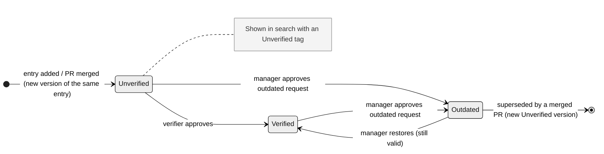
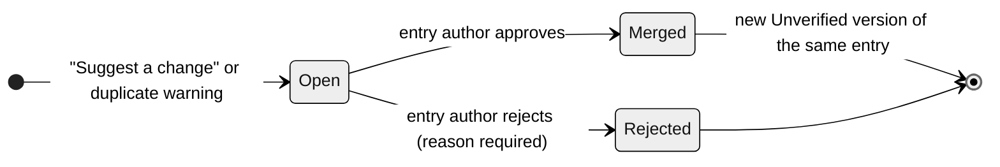
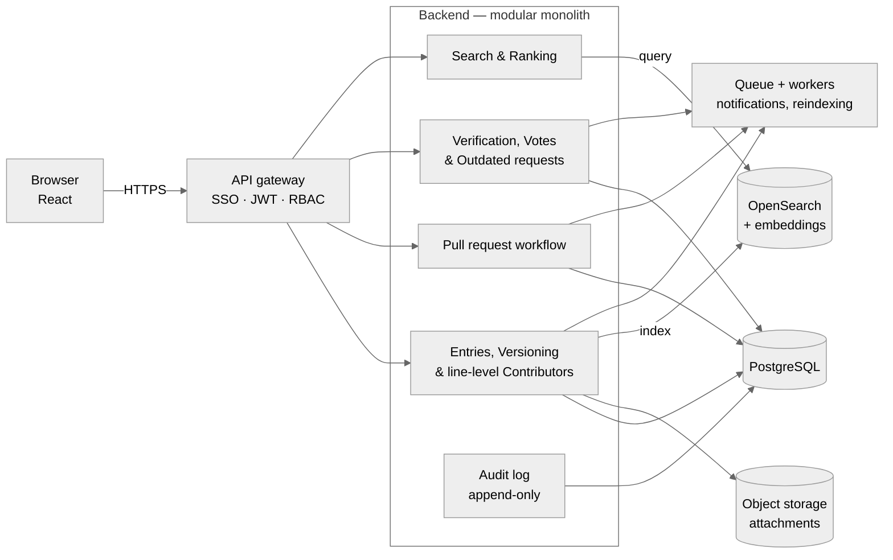

# Peerpoint — a knowledge database where trust comes from people

Peerpoint is an **internal knowledge database for SD Worx employees, enriched with human-processed feedback**. Every entry stores not only the information itself, but also the judgement of the people who work with it: who verified it, who used it where and whether it was correct, whether it is still current, and who is responsible for each part of the text.

- **Backend:** FastAPI + SQLAlchemy 2 + SQLite (Python 3.11)
- **Frontend:** Vite + React + TypeScript + Tailwind CSS + Lucide icons
- **Specification:** [FUNCTIONAL_SPEC.md](FUNCTIONAL_SPEC.md) (main) and [specs/ai-parser](specs/ai-parser/FUNCTIONAL_SPEC.md) (AI parser)

- **Hierarchical verification** — senior experts, team leads and managers approve entries, which then carry a role badge such as *"Verified by Senior Expert"* or *"Verified by Manager"*.
- **Peer review (from academia)** — every employee can report the usage of an entry they used, with a full usage record: who, when, where and whether it was correct.
- **Git-style version control** — duplicates and outdated information become pull requests to the existing entry, and every line shows who is responsible for it.
- **Contacts** — every author and contributor states whether the topic is their responsibility or relayed from a source, so a reader knows whom to ask.
- **Automatic knowledge capture (AI parser)** — much working knowledge is only said in Teams meetings or written in group chats. AI agents read meeting transcripts and group chats and extract the facts, rules and decisions in them, each with the exact quotes that support it, the person who said it and the colleagues who confirmed it. The agents only *propose*: every person decides on their own suggestion (approve, reject or postpone) in the **Information overview**, and an approved suggestion becomes a normal Unverified entry that follows the usual verification. Transcripts are not kept after extraction, and only the people who took part in a conversation can see what was extracted from it.

Every entry answers the question *and* shows **why you can rely on it and who to ask about it**.

## How to run

You need **Python 3.11** and **Node.js** (with npm). Run the backend and the frontend in two terminals.

### 1. Backend (port 8000)

```bash
cd backend
python3.11 -m venv .venv
source .venv/bin/activate
pip install -r requirements.txt
python -m uvicorn app.main:app --reload --port 8000
```

Check it: http://127.0.0.1:8000/health (API docs: http://127.0.0.1:8000/docs).

On the first start the backend creates the SQLite database `backend/peerpoint.db` and seeds the demo data from `backend/mock_data/`. Its JWT signing keys are generated into `backend/.keys/` (git-ignored) the first time someone signs in. New columns on an existing database are added automatically at startup. To start from scratch, stop the backend, delete `backend/peerpoint.db` and start it again.

### 2. Frontend (port 5173)

```bash
cd frontend
npm install
npm run dev
```

Open http://localhost:5173 and pick a demo user. The dev server proxies `/api` to the backend on **port 8000** (`frontend/vite.config.ts`), so keep the backend there. If 5173 is busy, Vite uses the next free port and prints it; the backend allows 5173–5178.

### Tests and production build

```bash
cd backend && source .venv/bin/activate && python -m pytest -q   # backend tests
cd frontend && npm run build                                      # type-check and production build
```

### Settings

All optional; the defaults work for local development. Set them as environment variables before starting the backend.

| Variable | Default | Meaning |
|---|---|---|
| `DATABASE_URL` | `sqlite:///backend/peerpoint.db` | Database |
| `DEMO_MODE` | `true` | Demo user picker on the sign-in page; set `false` anywhere else |
| `IDP_MODE` | `mock` | `mock` serves a built-in identity provider under `/idp` |
| `SEED_HISTORY_DEMO` | `true` | Adds a three-version demo entry for the change log |
| `SEED_PARSER_DEMO` | `true` | Fills the Information overview from the mock meetings and chats |
| `CURSOR_API_KEY`, `CURSOR_MODEL`, `CURSOR_CLI_PATH`, `CURSOR_TIMEOUT_S` | — | Only for the real AI parser, see [AI parser](#ai-parser-cursor-cli) |

Token lifetimes, verification thresholds, reputation points and the AI parser's confidence threshold are Admin settings in the app (Admin page).

## Demo users

Pick one on the sign-in page ("Use" next to a name). Demo data lives in `backend/mock_data/*.json` (see its [README](backend/mock_data/README.md)).

| Name | Roles |
|------|-------|
| Employee A | employee |
| Employee B | employee |
| Employee C | employee |
| Senior Expert | employee, expert (Payroll dept) |
| Team Lead | employee, team_lead (own team) |
| Manager | employee, manager (own team) |
| Admin | employee, admin |

## Roles and permissions

| Role | Permissions |
|---|---|
| Employee | Search, add entries, edit own drafts, report usage (vote), submit outdated requests, open pull requests, request co-authorship of memes from their own meetings and chats |
| Author | Approve or reject pull requests on their own entries (approval merges them), change their own authorship basis |
| Senior expert | Verify entries in their mapped departments; decide on a pull request only if the entry's author is inactive |
| Team lead | Verify entries of their own team; decide on a pull request only if the entry's author is inactive |
| Manager (and higher) | Same as team lead, plus decide on outdated requests and restore Outdated entries in their reporting line |
| Admin | Roles, department mapping, categories, tags, teams, projects and memberships, client companies and client projects, token lifetimes, thresholds and AI parser settings. Admins verify only as a fallback, and cannot read memes from conversations they did not take part in |

If nobody is in scope to verify an entry, any Manager or Admin can (fallback).

## State machines

**Entry version**



A duplicate warning when adding an entry is advisory: the entry can still be saved (Unverified, findable at once), optionally with a "why is this different?" note for verifiers.

**Pull request**



Only the entry author decides; if the author is no longer active, a verifier in scope decides instead. A pull request opened by the entry author merges at once.

## What is in the app

- **Search** with ranking (verification, votes, scope, freshness), a filter panel (country, department, category, status, scope, verifier role, author, team, company, client project, tags, date range) and shareable URLs
- **Entries** with versions, git-style change log and diffs, per-line contributors, Contacts block, usage records, duplicate warning, outdated requests
- **Approvals** for verifiers, pull request approvals, outdated decisions for managers
- **People, teams and projects** with profiles and a Responsibilities tab
- **Tags** as shared entities (clickable, renamed and merged by Admins), **company and client-project scopes**
- **Sign-in** with an OAuth2 code flow (PKCE) against a built-in mock identity provider, RS256 JWTs and rotating refresh tokens
- **Information overview** (AI parser): suggestions extracted from meetings and group chats, decided per person (approve, reject, postpone), published through the Add entry form; co-authorship requests after publication
- Notifications, My contributions, Admin panel

## Notes

- Scope values: `country`, `eu`, `universal`, `company`, `client_project`
- Public ID format: `PP-{CC}-{CAT}-{seq}` e.g. `PP-BE-FRE-00042`
- Authentication details: [backend/README.md](backend/README.md); the full, current list of endpoints is the interactive API documentation at http://127.0.0.1:8000/docs
- AI parser for Teams meetings and group chats — spec: [specs/ai-parser/FUNCTIONAL_SPEC.md](specs/ai-parser/FUNCTIONAL_SPEC.md); output and usage: [backend/memes/README.md](backend/memes/README.md)

## Target architecture

What runs today is a modular monolith on SQLite. The picture below is the intended production setup: PostgreSQL as the source of truth, OpenSearch for search and similarity, and a queue with workers for notifications and reindexing.



## AI parser (Cursor CLI)

The demo needs none of this: with `SEED_PARSER_DEMO` on (default), the Information overview is filled from the expected memes of the mock meetings and chats. The real parser runs the Cursor CLI headless, so the machine running the backend needs it once:

```bash
curl https://cursor.com/install -fsS | bash
```

```bash
agent login
```

Instead of `agent login`, export `CURSOR_API_KEY` in the shell that starts the backend. Optional environment variables: `CURSOR_MODEL` (see `agent models`; default: `auto`), `CURSOR_CLI_PATH`, `CURSOR_TIMEOUT_S`.

```bash
cd backend && source .venv/bin/activate && python -m app.ai_parser --all
```

This writes the agent's memes for all mock sources into `backend/memes/`, to compare them with the expected memes (`python -m app.ai_parser.eval`). The demo database is filled from the expected memes instead (`seed_parser_demo`).

Flow for real sources: a participant uploads the transcript or chat export with `POST /parser/sources` (multipart: `file`, `type` = `meeting` | `chat`, and for meetings `title`, `date`, `participant_ids`); the agent runs in the background (`GET /parser/runs/{id}` shows the status); the memes are stored through the Information overview's import, every speaker and confirmer gets their own suggestion, and all participants a notification. The suggestions are then decided on the Information overview page (`/information`). There is no upload screen in the frontend yet.
