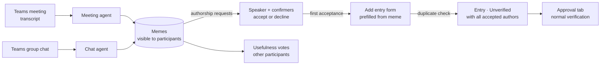
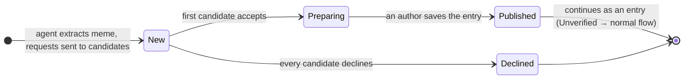
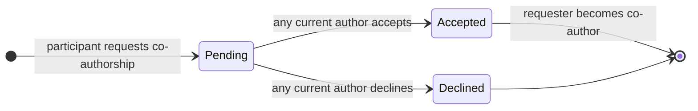

# Peerpoint AI parser — Functional Specification

*Extension of the [main functional specification](../../FUNCTIONAL_SPEC.md) · draft · 2026-10-20*

## Contents

1. [Purpose and scope](#1-purpose-and-scope)
2. [Key concepts](#2-key-concepts)
3. [Actors and permissions](#3-actors-and-permissions)
4. [Pipeline and lifecycles](#4-pipeline-and-lifecycles)
5. [Functional requirements](#5-functional-requirements)
6. [Agent contract](#6-agent-contract)
7. [Use cases](#7-use-cases)
8. [Business rules](#8-business-rules)
9. [Screens and notifications](#9-screens-and-notifications)
10. [Phasing and open questions](#10-phasing-and-open-questions)

---

## 1. Purpose and scope

Much of SD Worx's working knowledge is said out loud in Teams meetings or written in group chats, and never reaches the knowledge base. The AI parser closes that gap: two AI agents read meeting transcripts and group chats and extract **memes**, which are self-contained units of information, each tied to the people who stand behind it.

The core principle of Peerpoint still holds: **algorithms help people find information; people decide whether it can be trusted.** An agent only proposes. A meme reaches the shared repository only when one of its authors (the person who said it, or a colleague who confirmed it in the conversation) accepts it, and from that point it follows the normal entry lifecycle (Unverified → verification by a verifier in scope).

Authorship is also about **whom to ask**. The authors of an entry are the people future readers can contact about the topic. Each author therefore states their basis: either answering such questions is their **direct responsibility** (part of their job), or they **relayed** something they read or heard, naming the source.

**In scope:**

- **Meeting agent** — parses Teams meeting transcripts into memes.
- **Chat agent** — reads and analyzes Teams group chats and extracts memes from them.
- **Authorship** — the speaker and everyone who confirmed the statement in the conversation receive an authorship request; each accepts or declines; one acceptance is enough to prepare the meme for publication, with every accepting person as an author. Even after publication, a participant can request co-authorship, and the current authors decide.
- **Contacts** — accepted authors state their basis (Responsible, or Relayed with a source) as for any entry ([main spec](../../FUNCTIONAL_SPEC.md), FR-K); co-authors appear in the entry's Contacts block and on their profile's Responsibilities tab.
- **Memes page** — every participant of a meeting or chat sees all memes from it, filtered by *Meetings* and *Group chats*.
- **Usefulness votes** — the other participants see the meme's current status and vote on its usefulness, in a separate tab.

**Out of scope:** meeting recordings without a transcript (no speech-to-text), 1:1 private chats, e-mail.

## 2. Key concepts

- **Source** — one meeting transcript or one group chat (or a time range of it) that the agents processed. It has a type (`meeting` or `chat`), a title, a date or date range, and a participant list.
- **Participant** — a user recorded on the source's participant list: an attendee of the meeting or a member of the chat at import time.
- **Meme** — one self-contained unit of information extracted from a source: a fact, rule, decision or how-to that makes sense without reading the conversation. Every meme has exactly one speaker, zero or more confirmers, and at least one quote from the source that supports it.
- **Speaker** — the participant who said or wrote the information.
- **Confirmer** — another participant who explicitly confirmed the speaker's statement in the same conversation ("yes, that's correct, we changed it in September"). Acknowledging that one has heard something ("ok", "mm-hmm") is not a confirmation.
- **Author candidates** — the speaker and all confirmers of a meme. Each of them receives an **authorship request**.
- **Authors** — the candidates who accepted their request. The meme is published with all of them as authors.
- **Tags** — the shared tag entities of the main spec (FR-T1), linked many-to-many to memes as well as to entries. When a meme is published, the entry is linked to the same tags; clicking a tag opens Search with it pre-filled.
- **Scope** — as in the main spec (BR-9): universal, EU-wide, country, company or project; agents suggest it per meme.
- **Authorship basis, contacts, profile** — as defined in the main spec (section 3, FR-K, BR-8): every author is Responsible, or Relayed with a source; authors are listed as contacts on the entry and on their profile's Responsibilities tab.
- **Quote** — an exact source fragment, with a timestamp (meeting) or message reference (chat). The statement and every confirmation each have their own quote.
- **Usefulness vote** — a participant's judgement of whether a colleague's meme is worth keeping: *useful* or *not useful*. It is separate from the usage-record votes on entries (FR-P in the main spec).
- **Published meme** — a meme an author added to the repository. It is linked to the resulting entry's public ID.

## 3. Actors and permissions

| Action | Author candidate (speaker or confirmer) | Other participant of the source | Non-participant | Admin |
| --- | --- | --- | --- | --- |
| Import a meeting transcript or group chat | If participant | If participant | No | No |
| See memes of a source | Yes | Yes | No | No |
| See quotes and their context | Yes | Yes | No | No |
| Accept or decline an authorship request | Own request | No | No | No |
| Add a meme to the repository (publish) | After accepting | No | No | No |
| Edit meme text, scope and tags before publishing | After accepting | No | No | No |
| Request co-authorship of a published meme | If not an author | Yes | No (suggest a change to the entry instead) | No |
| Decide on a co-authorship request | If an author | No | No | No |
| Set or change own authorship basis and source | Own, as an author | No | No | No |
| Vote on usefulness | Only after declining | Yes | No | No |
| See status, candidates' responses and vote counts | Yes | Yes | No | No |
| See the published entry | Yes | Yes | Yes (normal entry) | Yes (normal entry) |
| Configure agents (thresholds, retention) | No | No | No | Yes |

Admins configure the agents but cannot read memes from conversations they did not take part in. Being a platform owner gives no access to private conversations.

## 4. Pipeline and lifecycles

### Pipeline



### Meme lifecycle



- **New** — extracted and visible to participants; authorship requests are pending.
- **Preparing** — at least one candidate accepted; the meme is being prepared for publication. Candidates who have not answered yet can still accept and join as authors.
- **Published** — an author saved the entry. The meme shows the entry's public ID and its current entry status (Unverified, Verified or Outdated). It can still gain co-authors through co-authorship requests.
- **Declined** — every candidate declined. The meme stays visible to participants with that status.

### Authorship request lifecycle

Each candidate has their own request, independent of the others.

| State | Meaning |
| --- | --- |
| Pending | Sent, no answer yet |
| Accepted | The candidate is an author; they can open and save the entry |
| Declined | The candidate refused, with an optional reason: not relevant, incorrect, or "I didn't say / confirm this" |
| Closed | The meme was published before the candidate answered; they can still request co-authorship |

### Co-authorship request after publication

Before publication, the system asks the candidates. After publication, the direction is reversed: a participant who is not an author asks the authors.



Usefulness voting is open while a meme is **New** or **Preparing**. On publishing or decline the counts freeze and stay visible. After publishing, colleagues give feedback through the entry's usage records.

## 5. Functional requirements

Phase marks what the hackathon PoC delivers (MVP) and what follows (Phase 2).

### Common agent rules

| ID | Requirement | Phase |
| --- | --- | --- |
| FR-MA1 | Both agents produce memes in one shared format (see [Agent contract](#6-agent-contract)). | MVP |
| FR-MA2 | Every meme is self-contained: pronouns and references such as "this client" or "the new rule" are resolved, so it reads correctly outside the conversation. | MVP |
| FR-MA3 | Every meme carries at least one quote from the source with a timestamp or message reference. A statement that no quote supports is not a meme. | MVP |
| FR-MA4 | Every meme has exactly one speaker, mapped to a Peerpoint user. A statement whose speaker cannot be mapped to a user is not extracted. | MVP |
| FR-MA5 | Agents extract only knowledge: facts, rules, decisions and how-tos. Small talk, opinions, task assignments and questions without an answer are skipped. | MVP |
| FR-MA6 | Agents suggest a title, category, country and scope for each meme, used to prefill the Add entry form. When the information is valid only for one client or one project, the scope is company or project, with that company or project (BR-9 of the main spec). | MVP |
| FR-MA7 | Agents give each meme a confidence score; memes below the configurable threshold are not shown. | MVP |
| FR-MA8 | The same information said several times in one source becomes one meme with several quotes. | MVP |
| FR-MA9 | Each meme is compared with existing repository entries (BR-2 of the main spec); similar entries are listed on the meme. | MVP (keyword), Phase 2 (embeddings) |
| FR-MA10 | Agents flag memes that contain personal data or confidential customer data (see [BR-M5](#br-m5-sensitive-data)). | MVP |
| FR-MA11 | Agents detect confirmations: another participant explicitly agreeing with the content of the statement after it was made. Each confirmer is recorded with the quote of their confirmation. | MVP |
| FR-MA12 | Agents tag every meme. A tag is linked to an existing tag entity when the names match after normalization (FR-T1 of the main spec); a new tag is created only when no existing tag fits. | MVP |

### Meeting agent

| ID | Requirement | Phase |
| --- | --- | --- |
| FR-MT1 | A participant can upload a Teams meeting transcript (`.vtt`, `.docx` or `.txt` export) with the meeting title and date. | MVP |
| FR-MT2 | The participant list is prefilled from the transcript's speakers and can be completed by the uploader with silent attendees. | MVP |
| FR-MT3 | The agent maps transcript speaker names to Peerpoint users and asks the uploader to confirm unresolved names before extraction. | MVP |
| FR-MT4 | The agent segments the meeting into topics and extracts memes per topic, keeping the timestamp of every quote. | MVP |
| FR-MT5 | When a speaker corrects themselves or is corrected later in the meeting, the meme reflects the final, corrected statement and quotes both. | MVP |
| FR-MT6 | Transcripts are fetched automatically from Microsoft Graph for meetings where the organizer enabled Peerpoint, with the attendance report as participant list. | Phase 2 |

### Chat agent

| ID | Requirement | Phase |
| --- | --- | --- |
| FR-MC1 | A participant can import a Teams group chat export for a chosen date range. | MVP |
| FR-MC2 | The participant list is the chat's member list at import time. | MVP |
| FR-MC3 | The agent reconstructs threads and reply chains before extraction; information spread over several messages becomes one meme. | MVP |
| FR-MC4 | In question–answer exchanges, the person who gave the answer is the speaker; the question alone is never a meme. | MVP |
| FR-MC5 | When a later message in the chat contradicts or updates an earlier statement, the agent keeps only the latest one and quotes both. | MVP |
| FR-MC6 | In chats, an explicit reply confirming a statement counts as a confirmation. Reactions (e.g. 👍) may raise the confidence score but never count as confirmations or usefulness votes. | MVP |
| FR-MC7 | Chats are read incrementally from Microsoft Graph; only new messages since the last run are analyzed, and existing memes are updated rather than duplicated. | Phase 2 |

### Authorship

| ID | Requirement | Phase |
| --- | --- | --- |
| FR-MO1 | Every author candidate of a meme (the speaker and each confirmer) receives an authorship request. A confirmer's request shows the quote in which they confirmed. | MVP |
| FR-MO2 | Each candidate accepts or declines their own request independently. Accepting requires an authorship basis (FR-MO15); a decline takes an optional reason (not relevant, incorrect, "I didn't say / confirm this"). | MVP |
| FR-MO3 | As soon as at least one candidate accepts, the meme moves to Preparing; nobody has to wait for the other candidates. | MVP |
| FR-MO4 | While the meme is Preparing, pending candidates can still accept and are added as authors. | MVP |
| FR-MO5 | When every candidate has declined, the meme becomes Declined. | MVP |
| FR-MO6 | Each candidate sees the other candidates, their responses and decline reasons. | MVP |
| FR-MO7 | When the entry is saved, pending requests are closed and those candidates are notified that the meme was published without them and that they can still request co-authorship (FR-MO10). | MVP |
| FR-MO8 | A candidate who accepted can withdraw from authorship while the meme is still Preparing; if no author remains, the meme returns to New. | MVP |
| FR-MO9 | A candidate who declined with "I didn't say / confirm this" can be replaced by the uploader with the right person, who then receives a request. | Phase 2 |
| FR-MO10 | After publication, any participant of the source who is not an author — including candidates who declined or whose request was closed — can request co-authorship from the meme or from the entry page, with their authorship basis (FR-MO15) and an optional note. | MVP |
| FR-MO11 | The request shows the requester's evidence: their agent-detected quote if they were a candidate; otherwise they can point to the moment in the source (timestamp or message) where they said or confirmed the information. | MVP |
| FR-MO12 | The request goes to all current authors; the first author to answer decides, accepting or declining with an optional reason. | MVP |
| FR-MO13 | On acceptance the requester becomes a co-author of the entry. The entry's text, version and status do not change: no new version is created and verification is kept. | MVP |
| FR-MO14 | One open request per person per meme; a declined request cannot be repeated. | MVP |
| FR-MO15 | When accepting an authorship request or requesting co-authorship, the author chooses their basis: **Responsible** or **Relayed**. Relayed requires a source (FR-K1 of the main spec). | MVP |
| FR-MO16 | The basis and source are prefilled from the agent's hint when the conversation makes them clear (e.g. "according to the legal circular…", "I read in the newsletter…", "our team handles these"); the author always confirms or changes them. | MVP |
| FR-MO17 | An author can change their basis and source later, as for any entry (FR-K2 and FR-K10 of the main spec). | MVP |

### Memes page and visibility

| ID | Requirement | Phase |
| --- | --- | --- |
| FR-MS1 | A **Memes** page lists the memes of all sources the current user participated in. | MVP |
| FR-MS2 | The page has two filters, **Meetings** and **Group chats**, which can be combined; with neither selected, both are shown. | MVP |
| FR-MS3 | The page has two tabs: **My memes** (memes where the current user is an author candidate, pending requests first) and **Colleagues' memes** (all other memes of the user's sources, with usefulness voting). Together they show all memes of the user's sources. | MVP |
| FR-MS4 | Each meme shows its statement, speaker, confirmers, source (title, type, date), status, candidates' responses and usefulness counts; it expands to show the quotes with a few lines of surrounding context. | MVP |
| FR-MS5 | Visibility is enforced server-side: only participants of a source can list or open its memes, quotes and context. | MVP |
| FR-MS6 | A published meme shows the entry's public ID, current entry status badge and authors, with a link to the entry. | MVP |
| FR-MS7 | Memes can additionally be filtered by one specific source and by status. | Phase 2 |
| FR-MS8 | Each meme shows its scope and its tags. Clicking a tag opens the Search page with that tag pre-filled (FR-T3 of the main spec), so the author can see what the repository already holds on the topic. | MVP |
| FR-MS9 | The Memes page can also be filtered by tag. | Phase 2 |

### Publishing to the repository

| ID | Requirement | Phase |
| --- | --- | --- |
| FR-MP1 | Only authors (candidates who accepted) can add a meme to the repository; the action is not shown to anyone else, and the server rejects it for anyone else. | MVP |
| FR-MP2 | "Add to repository" opens the Add entry form prefilled with the meme's title, statement, suggested category, country and scope (with company or project) and its tags; the author can edit everything before saving. | MVP |
| FR-MP3 | Before saving, the form shows all candidates with their responses, including decline reasons, so the author knows who is still pending and who objected. | MVP |
| FR-MP4 | The justification is prefilled with the source reference (type, title, date), not with quotes or transcript text. If the saving author relayed the information, their source is added to it. | MVP |
| FR-MP5 | Saving follows the normal entry flow: duplicate warning (FR-D in the main spec), then a new **Unverified** entry that appears in the approval tab of verifiers in scope. | MVP |
| FR-MP6 | The author who saves becomes the entry's author; every other accepted author is recorded as co-author, i.e. a contributor in the sense of FR-H2 and BR-7 of the main spec, and shown on the entry page. | MVP |
| FR-MP7 | If several authors open the form, the first save publishes the meme; the others are told it is already published and see the entry. | MVP |
| FR-MP8 | The entry keeps a link to its origin meme; the entry page shows "From a meeting" or "From a group chat" with the source date, without revealing the conversation to non-participants. | MVP |
| FR-MP9 | On publishing, the entry is linked to the meme's tags as they were saved in the form; the meme keeps its own tags. | MVP |

### Contacts

Contacts, the authorship basis and the profile's Responsibilities tab are defined in the main spec (FR-K1–K13, BR-8). For memes, every accepted author — including co-authors who joined after publication — is a contact of the entry with the basis they chose (FR-MO15), and the entry appears on their Responsibilities tab.

### Usefulness votes

| ID | Requirement | Phase |
| --- | --- | --- |
| FR-MV1 | In the **Colleagues' memes** tab, every participant who is not an author candidate of the meme — or who declined their request — can vote a New or Preparing meme *useful* or *not useful*. | MVP |
| FR-MV2 | One vote per user per meme; the user can change or withdraw it while voting is open. | MVP |
| FR-MV3 | Useful and not-useful counts are shown on the meme to all participants, including the candidates in **My memes**. | MVP |
| FR-MV4 | Usefulness votes do not transfer to the entry's correct / incorrect counts and do not affect verification. | MVP |
| FR-MV5 | When a New meme reaches the configurable number of useful votes, all pending candidates are nudged to answer their request. | MVP |

### Notifications

| ID | Requirement | Phase |
| --- | --- | --- |
| FR-MN1 | In-app notifications for: memes ready after an import, authorship request received, a co-candidate accepted, useful-vote threshold reached, meme published (with or without you), co-authorship requested after publication, co-authorship request decided. | MVP |
| FR-MN2 | Weekly digest of authorship requests still pending. | Phase 2 |

## 6. Agent contract

Both agents return a list of memes in the same format. The backend validates it, maps speakers and confirmers to users, stores memes as **New** and sends authorship requests.

```json
{
  "source": { "type": "meeting", "title": "Payroll BE weekly", "date": "2026-10-14" },
  "speaker": "employee.a@sdworx.example",
  "speaker_basis_hint": { "basis": "responsible" },
  "kind": "rule",
  "statement": "Contractor invoices received after the 25th are processed in the next month's payroll run.",
  "suggested": {
    "title": "Cut-off date for contractor invoices",
    "category": "Freelance / contractor payroll",
    "country": "BE",
    "scope": "country"
  },
  "tags": ["contractor", "invoice", "cut-off"],
  "quotes": [
    { "speaker": "employee.a@sdworx.example", "text": "So anything that comes in after the twentieth — no, sorry, the twenty-fifth — goes into next month's run.", "at": "00:12:31" }
  ],
  "confirmed_by": [
    {
      "user": "employee.c@sdworx.example",
      "quote": { "text": "Yes, that's right, it was in the payroll newsletter in September.", "at": "00:12:40" },
      "basis_hint": { "basis": "relayed", "source": "Payroll newsletter, September 2026" }
    }
  ],
  "confidence": 0.82,
  "sensitive": false,
  "similar_entries": []
}
```

| Field | Meaning |
| --- | --- |
| `source` | Type (`meeting` or `chat`), title and date or date range of the processed source |
| `speaker` | The user who said or wrote the information; exactly one |
| `kind` | `fact`, `rule`, `decision` or `how-to` |
| `statement` | Self-contained text of the meme, in the language of the source |
| `suggested` | Prefill for the Add entry form: `title`, `category`, `country` and `scope` (`universal`, `eu`, `country`, `company` or `project`); for a company or project scope also `company` or `project` with its name |
| `tags` | Tag names; the backend links them to existing tag entities (many-to-many) or creates new ones (FR-MA12) |
| `quotes` | One or more fragments supporting the statement; `at` is a timestamp (meeting) or message ID (chat) |
| `speaker_basis_hint`, `confirmed_by[].basis_hint` | Suggested authorship basis (`responsible`, or `relayed` with a `source`) when the conversation makes it clear; `null` otherwise. Only a prefill: the author decides (FR-MO16) |
| `confirmed_by` | Participants other than the speaker who explicitly confirmed the statement, each with the quote of their confirmation; may be empty |
| `confidence` | 0–1; memes below the admin threshold are dropped |
| `sensitive` | `true` when the meme or its quotes contain personal data or confidential customer data; a client named only through a company or project scope does not count |
| `similar_entries` | Existing entries above the similarity threshold, from the existing similarity service |

For the demo, sample sources go into `backend/mock_data/` next to the other mock data; the six demo scenarios (three meetings, three group chats) with their expected memes are described in [MOCK_SCENARIOS.md](MOCK_SCENARIOS.md).

## 7. Use cases

### UC-M1 Import a meeting transcript

**Actor:** Employee A (participant) · **Covers:** FR-MT1–MT5, FR-MA1–MA11, FR-MO1, FR-MN1

1. After a Teams meeting, A uploads the transcript, enters the meeting title and date.
2. The system prefills participants from the transcript speakers; A confirms unresolved names and adds silent attendees.
3. The meeting agent extracts memes, with speakers and confirmers; participants are notified that memes are ready, and every candidate receives their authorship requests.

**Acceptance criteria**

- [ ] Every meme has exactly one speaker who is on the participant list.
- [ ] Every meme has at least one quote with a timestamp that exists in the transcript.
- [ ] Every confirmer is a participant other than the speaker and has a confirmation quote that comes after the statement.
- [ ] "Ok", "mm-hmm" and similar acknowledgements produce no confirmers.
- [ ] Small talk, task assignments and unanswered questions produce no memes.
- [ ] Non-participants cannot see that the import exists.

### UC-M2 Analyze a group chat

**Actor:** Employee B (chat member) · **Covers:** FR-MC1–MC7, FR-MA1–MA11

1. B imports the group chat for a date range.
2. The chat agent rebuilds threads, pairs questions with answers, detects confirming replies and extracts memes.
3. Chat members are notified that memes are ready; candidates receive their requests.

**Acceptance criteria**

- [ ] In a question–answer pair the answering person is the speaker.
- [ ] An explicit confirming reply makes its author a confirmer; a reaction does not.
- [ ] A statement updated later in the chat yields one meme with the latest information, quoting both messages.

### UC-M3 Browse memes

**Actor:** any participant · **Covers:** FR-MS1–MS6

1. The user opens **Memes** and switches between **My memes** and **Colleagues' memes**.
2. They filter by **Meetings**, **Group chats** or both.
3. They expand a meme to read the quotes and their context.

**Acceptance criteria**

- [ ] Only memes from sources the user participated in are listed, in either tab.
- [ ] Opening a meme of a foreign source by URL or API returns not found.
- [ ] Each meme shows status, speaker, confirmers, source, candidates' responses and usefulness counts.

### UC-M4 Accept authorship and publish

**Actors:** Employee A (speaker), Employee C (confirmed the statement in the meeting) · **Covers:** FR-MO1–MO8, FR-MO15–MO16, FR-MP1–MP8, main spec UC-1 and FR-K3

1. After the import, A and C each receive an authorship request; C's request shows the quote in which C confirmed.
2. C accepts as **Relayed**, keeping the prefilled source "Payroll newsletter, September 2026"; the meme becomes Preparing. A has not answered yet.
3. A accepts as **Responsible**, since contractor cut-offs are part of A's job, and is added as an author.
4. C clicks "Add to repository", sees both authors' responses, edits the prefilled form; the duplicate check runs; C saves.
5. The entry is created as Unverified with C as author and A as co-author; the meme becomes Published. The entry's Contacts block shows A as "Responsible for this topic" first, then C as "Added from source: Payroll newsletter, September 2026".

**Acceptance criteria**

- [ ] One acceptance is enough to move the meme to Preparing.
- [ ] Accepting is impossible without a basis, and Relayed is impossible without a source.
- [ ] "Add to repository" is available only to candidates who accepted, in the UI and on the server.
- [ ] Every accepted author appears on the entry; candidates who declined do not.
- [ ] Requests still pending at save time are closed, and those candidates are notified.
- [ ] The new entry starts Unverified with zero votes; its authors can neither vote on it nor verify it.
- [ ] The entry's justification references the source, not the transcript text.

### UC-M5 Vote on a colleague's meme

**Actor:** Employee B (participant, not a candidate) · **Covers:** FR-MV1–MV5

1. In **Colleagues' memes**, B sees A's meme with status New.
2. B votes *useful*; the count updates for all participants.
3. When the useful-vote threshold is reached, pending candidates are nudged to answer.

**Acceptance criteria**

- [ ] A candidate who has not declined cannot vote on the meme.
- [ ] A second vote by the same user replaces the first instead of adding to it.
- [ ] Voting is closed once the meme is Published or Declined.

### UC-M6 Decline authorship

**Actors:** Employee C (confirmer), Employee A (speaker) · **Covers:** FR-MO2, FR-MO5, FR-MO6

1. C only agreed out of politeness and does not want to stand behind the statement; C declines with a reason.
2. A also declines; the meme becomes Declined.

**Acceptance criteria**

- [ ] C's decline does not change A's request.
- [ ] Decline reasons are visible to the other candidates.
- [ ] When every candidate has declined, the meme can no longer be published or voted on.

### UC-M7 Request co-authorship after publication

**Actors:** Employee A (speaker whose request was closed), Employee C (author) · **Covers:** FR-MO10–MO15

1. C published the meme before A answered; A's request was closed and A was notified.
2. A opens the meme (or the entry), clicks "Request co-authorship" and chooses a basis; the request shows A's original quote.
3. C receives the request and accepts it.
4. A appears as co-author on the entry; the entry keeps its version and status.

**Acceptance criteria**

- [ ] Any participant of the source who is not an author can request; a non-participant is offered "Suggest a change" on the entry instead.
- [ ] Only current authors can decide, and the first answer decides.
- [ ] Accepting does not create a new version and does not reset verification.
- [ ] A participant with an active usage vote on the entry, or who verified its current version, cannot request co-authorship.
- [ ] After a decline, the same person cannot request again for that meme.

Finding whom to ask about a published meme, and seeing a person's responsibilities, follows UC-8 of the main spec.

## 8. Business rules

All thresholds below are configurable by Admins; the values given are PoC defaults.

### BR-M1 Visibility

- A meme is visible exactly to the participants of its source; this is checked server-side on every request.
- The participant list is fixed at import time. People who join a chat later do not see memes from earlier imports.
- Once published, the **entry** is visible to everyone like any other entry; the meme, its quotes and the conversation context remain participant-only.

### BR-M2 Authorship

- Author candidates are the speaker and every confirmer. A confirmation is explicit agreement with the content of the statement, made after it in the same conversation; acknowledgements and reactions are not confirmations.
- Each candidate decides alone. One acceptance is enough to prepare the meme for publication; the meme is published with every candidate who accepted as an author. Declining excludes only that candidate.
- If the speaker declines but a confirmer accepts, the meme can still be published, without the speaker as author. The speaker's decline reason is shown to the authors before they save.
- Nobody who is not an accepted author can publish a meme: not the uploader, not a manager, not an admin.
- After publication, co-authorship is never self-service: a participant requests it and one of the current authors decides. Non-participants contribute to the entry only through the pull request flow of the main spec.
- To request co-authorship after publication, the requester must first withdraw any usage vote they have on the entry, and must not be a verifier of its current version — so nobody can vote on or verify an entry and then become its author.
- A co-author who joins after publication earns reputation points for correct usage votes (BR-5 of the main spec) only for votes received after joining; earlier votes are not counted retroactively.

### BR-M3 Publishing

- A meme never becomes an entry automatically; publishing is always an explicit action of an accepted author.
- A published meme becomes a regular entry: it starts Unverified, goes through duplicate detection and verification, and earns no extra trust from its usefulness votes or from the number of authors.
- Co-authors are contributors of the entry in the sense of the main spec: they earn reputation as contributors (BR-5), cannot vote on it (FR-P2), and cannot verify it. A verifier who confirmed a statement in a meeting must decline authorship to remain able to verify the entry.

### BR-M4 Usefulness votes

- One vote per participant per meme; no votes from candidates who have not declined.
- Votes are open while the meme is New or Preparing; counts freeze afterwards.
- Default nudge threshold: 3 useful votes.

### BR-M5 Sensitive data

- SD Worx conversations often mention employees, salaries and customers. Agents flag any meme or quote containing personal data or confidential customer data (contacts, rates, contract terms, the client's staff) as `sensitive`.
- Naming the client through a company or project scope is not sensitive (BR-9 of the main spec); the statement itself still must not contain the data above.
- A sensitive meme cannot be published until the author has edited the text and confirmed that it no longer contains such data.
- Quotes and context are never copied into the entry.

### BR-M6 Agent quality

- No quote, no meme: every statement must be supported by the quoted source fragments, and the agent must not add facts that are not in the source. The same holds for confirmations: no confirmation quote, no confirmer.
- Default confidence threshold: 0.6.
- Default similarity threshold for listing similar entries: the duplicate threshold of the main spec (60 %).

### BR-M7 Retention

- The raw transcript or chat export is kept only until extraction is finished and the uploader has confirmed the result; default: 30 days.
- Memes and their quotes are kept; the context shown around quotes is cut from the stored quotes, not from the raw source.

### BR-M8 Authorship basis

- BR-8 of the main spec applies to every meme author.
- The source of a relayed author is shown on the entry to every reader, so it must not contain quotes from the conversation or sensitive data (BR-M5).

## 9. Screens and notifications

| Screen | Main content | Key actions | Use cases |
| --- | --- | --- | --- |
| Import source | Upload transcript or chat export, title, date, participant list | Upload, confirm speakers and participants | UC-M1, UC-M2 |
| Memes — tab **My memes** | Memes where the user is speaker or confirmer, pending requests first; status, other candidates' responses, usefulness counts, similar entries, scope and clickable tags; filters Meetings / Group chats | Accept (choosing Responsible or Relayed with source) or decline authorship, withdraw while Preparing, add to repository, request co-authorship of a published meme, decide on incoming co-authorship requests, expand quotes | UC-M3, UC-M4, UC-M6, UC-M7 |
| Memes — tab **Colleagues' memes** | Other memes from the user's sources with speaker, confirmers, status, usefulness counts, scope and clickable tags; filters Meetings / Group chats | Vote useful / not useful, change or withdraw vote, request co-authorship of a published meme, expand quotes | UC-M3, UC-M5, UC-M7 |
| Add entry form (existing) | Prefilled from the meme, plus candidates and their responses | Edit, save, create PR instead | UC-M4 |
| Entry page (existing) | Adds an origin line ("From a meeting / group chat, date"); co-authors appear in the Contacts block (main spec FR-K3) | Request co-authorship (participants of the source only) | UC-M4, UC-M7 |

A **Memes** item is added to the main navigation next to Search.

| Event | Recipient | Channel (MVP) |
| --- | --- | --- |
| Memes ready after an import | All participants of the source | In-app |
| Authorship request | Each candidate (speaker and confirmers) | In-app |
| A candidate accepted | The other candidates | In-app |
| Useful-vote threshold reached | Pending candidates | In-app |
| Meme published | Authors, candidates whose request was closed, participants who voted on it | In-app |
| Co-authorship requested after publication | All current authors | In-app |
| Co-authorship request accepted or declined | Requester | In-app |

## 10. Phasing and open questions

**MVP (hackathon PoC):** manual upload of a meeting transcript and a group chat export; both agents with the shared output format, including confirmations; authorship requests with accept / decline; Memes page with the two tabs and the Meetings / Group chats filters; server-side participant visibility; publishing through the prefilled Add entry form with all accepted authors; co-authorship requests after publication; authorship basis chosen on accepting (contacts and profiles as in the main spec); usefulness votes; scope and tags on memes, with tag links to Search; sensitive-data flag; in-app notifications.

**Phase 2:** Microsoft Graph integration (automatic transcripts, incremental chat reading); replacing wrongly detected candidates; embedding-based similarity; source, status and tag filters; weekly digest.

### Open questions

- [ ] Consent: does recording meetings for knowledge extraction need explicit participant consent or works-council approval, and who enables it — the organizer or every participant?
- [ ] If the speaker declines as "incorrect", should that block publication by confirmers, or only be shown as a warning (current rule)?
- [ ] Should co-authorship requests after publication have a time limit (e.g. until the entry gets its next version)?
- [ ] Can a co-author leave an entry after publication, and does that need anyone's approval?
- [ ] Should people who join a chat later see memes from before they joined?
- [ ] Should a high useful-vote count influence the entry's search ranking after publishing, or stay provenance only?- [ ] What happens to pending requests when a candidate leaves the company?
- [ ] Transcripts in Dutch or French: keep memes in the source language, or translate (FR-E6 of the main spec)?
- [ ] Which model and hosting the agents use, given that payroll conversations contain personal data (technical specification).
