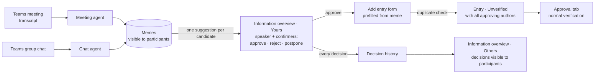
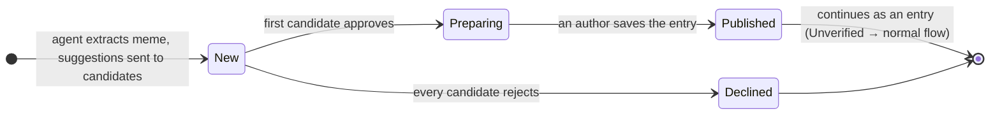
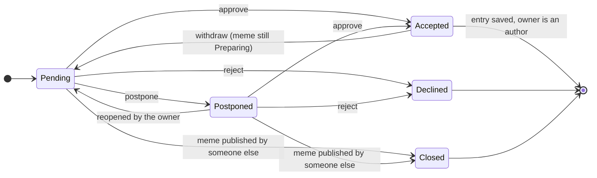
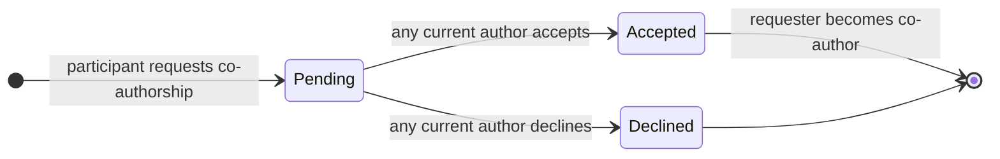

# Peerpoint AI parser — Functional Specification

*Extension of the [main functional specification](../../FUNCTIONAL_SPEC.md) · draft · 2026-10-20*

## Contents

1. [Purpose and scope](#1-purpose-and-scope)
2. [Key concepts](#2-key-concepts)
3. [Actors and permissions](#3-actors-and-permissions)
4. [Pipeline and lifecycles](#4-pipeline-and-lifecycles)
5. [Functional requirements](#5-functional-requirements)
6. [Agent contract](#6-agent-contract)
7. [Use cases](#7-use-cases)
8. [Business rules](#8-business-rules)
9. [Screens and notifications](#9-screens-and-notifications)
10. [Phasing and open questions](#10-phasing-and-open-questions)

---

## 1. Purpose and scope

Much of SD Worx's working knowledge is said out loud in Teams meetings or written in group chats, and never reaches the knowledge base. The AI parser closes that gap: two AI agents read meeting transcripts and group chats and extract **memes**, which are self-contained units of information, each tied to the people who stand behind it.

The core principle of Peerpoint still holds: **algorithms help people find information; people decide whether it can be trusted.** An agent only proposes. A meme reaches the shared repository only when one of its authors (the person who said it, or a colleague who confirmed it in the conversation) accepts it, and from that point it follows the normal entry lifecycle (Unverified → verification by a verifier in scope).

Authorship is also about **whom to ask**. The authors of an entry are the people future readers can contact about the topic. Each author therefore states their basis: either answering such questions is their **direct responsibility** (part of their job), or they **relayed** something they read or heard, naming the source.

**In scope:**

- **Meeting agent** — parses Teams meeting transcripts into memes.
- **Chat agent** — reads and analyzes Teams group chats and extracts memes from them.
- **Authorship** — the speaker and everyone who confirmed the statement in the conversation each receive their own **suggestion** (an authorship request); each approves, rejects or postpones it; one approval is enough to prepare the meme for publication, with every approving person as an author. Even after publication, a participant can request co-authorship, and the current authors decide.
- **Contacts** — accepted authors state their basis (Responsible, or Relayed with a source) as for any entry ([main spec](../../FUNCTIONAL_SPEC.md), FR-K); co-authors appear in the entry's Contacts block and on their profile's Responsibilities tab.
- **Information overview page** — the page where every participant of a meeting or chat sees the suggestions from it, in two tabs: **Yours** (the user's own suggestions, to approve, reject or postpone, with a separate **Postponed** section) and **Others** (what the other users decided about their own suggestions, with the decision history). Both tabs are paginated and can be filtered by *Meetings* and *Group chats*.
- **Decision history** — every decision on a suggestion is kept, append-only, and is visible to the other participants in their Others tab.

**Out of scope:** meeting recordings without a transcript (no speech-to-text), 1:1 private chats, e-mail.

## 2. Key concepts

- **Source** — one meeting transcript or one group chat (or a time range of it) that the agents processed. It has a type (`meeting` or `chat`), a title, a date or date range, and a participant list.
- **Participant** — a user recorded on the source's participant list: an attendee of the meeting or a member of the chat at import time.
- **Meme** — one self-contained unit of information extracted from a source: a fact, rule, decision or how-to that makes sense without reading the conversation. Every meme has exactly one speaker, zero or more confirmers, and at least one quote from the source that supports it.
- **Speaker** — the participant who said or wrote the information.
- **Confirmer** — another participant who explicitly confirmed the speaker's statement in the same conversation ("yes, that's correct, we changed it in September"). Acknowledging that one has heard something ("ok", "mm-hmm") is not a confirmation.
- **Author candidates** — the speaker and all confirmers of a meme. Each of them receives an **authorship request**.
- **Suggestion** — a meme as offered to one author candidate: that candidate's personal authorship request, shown on the Information overview page. **Every user has their own suggestions**: a meme with three candidates produces three suggestions, one per person, and each is decided by its owner alone. Other participants can see a suggestion and its decisions but cannot decide on it.
- **Decision** — the owner's answer to a suggestion: **Approve**, **Reject** or **Postpone**. Approve means accepting authorship (with an authorship basis) and adding the information to the repository through the prefilled Add entry form; Reject means declining it (with an optional reason); Postpone means "not now": the suggestion stays open in the Postponed section.
- **Decision history** — the append-only list of everything the owner did with a suggestion (each decision, withdrawal and change of mind, with date, time and reason or basis). It is kept for good and shown to the other participants.
- **Authors** — the candidates who approved (accepted) their suggestion. The meme is published with all of them as authors.

> **Vocabulary.** The page and its buttons say **Approve / Reject / Postpone**. In the rest of this spec "accept" is the same as Approve and "decline" the same as Reject; *Postpone* is the only answer without an older name.
- **Tags** — the shared tag entities of the main spec (FR-T1), linked many-to-many to memes as well as to entries. When a meme is published, the entry is linked to the same tags; clicking a tag opens Search with it pre-filled.
- **Scope** — as in the main spec (FR-E7, BR-11): universal, EU-wide, country, company or client project; agents suggest it per meme. A client project is not an internal Project of the main spec.
- **Authorship basis, contacts, profile** — as defined in the main spec (section 3, FR-K, BR-10): every author is Responsible, or Relayed with a source; authors are listed as contacts on the entry and on their profile's Responsibilities tab.
- **Quote** — an exact source fragment, with a timestamp (meeting) or message reference (chat). The statement and every confirmation each have their own quote.
- **Published meme** — a meme an author added to the repository. It is linked to the resulting entry's public ID.

## 3. Actors and permissions

| Action | Author candidate (speaker or confirmer) | Other participant of the source | Non-participant | Admin |
| --- | --- | --- | --- | --- |
| Import a meeting transcript or group chat | If participant | If participant | No | No |
| See memes of a source | Yes | Yes | No | No |
| See quotes and their context | Yes | Yes | No | No |
| Approve or reject (accept or decline) an authorship request | Own suggestion | No | No | No |
| Postpone an authorship request, and decide on it later | Own suggestion | No | No | No |
| See other candidates' suggestions, their decisions and decision history | Yes | Yes | No | No |
| Add a meme to the repository (publish) | After approving | No | No | No |
| Edit meme text, scope and tags before publishing | After approving | No | No | No |
| Request co-authorship of a published meme | If not an author | Yes | No (suggest a change to the entry instead) | No |
| Decide on a co-authorship request | If an author | No | No | No |
| Set or change own authorship basis and source | Own, as an author | No | No | No |
| See status and candidates' decisions | Yes | Yes | No | No |
| See the published entry | Yes | Yes | Yes (normal entry) | Yes (normal entry) |
| Configure agents (thresholds, retention) | No | No | No | Yes |

Admins configure the agents but cannot read memes from conversations they did not take part in. Being a platform owner gives no access to private conversations.

## 4. Pipeline and lifecycles

### Pipeline



### Meme lifecycle



- **New** — extracted and visible to participants; suggestions are pending or postponed.
- **Preparing** — at least one candidate approved; the meme is being prepared for publication. Candidates who have not decided yet, including those who postponed, can still approve and join as authors.
- **Published** — an author saved the entry. The meme shows the entry's public ID and its current entry status (Unverified, Verified or Outdated). It can still gain co-authors through co-authorship requests.
- **Declined** — every candidate rejected. A postponed suggestion is not a rejection, so a meme with a postponed suggestion stays New. The meme stays visible to participants with its status.

### Suggestion lifecycle (authorship request)

Each candidate has their own suggestion, independent of the others. The owner is the only person who can decide on it.

| State | Button / label | Meaning | Shown to the owner in |
| --- | --- | --- | --- |
| Pending | — | Sent, no decision yet | Yours → To decide |
| Postponed | **Postpone** | The owner put the decision off; it stays open and counts as undecided | Yours → Postponed |
| Accepted | **Approve** | The candidate is an author; they can open and save the entry. Until the entry is saved the suggestion reads "Approved, not yet added" | Yours → Decided |
| Declined | **Reject** | The candidate refused, with an optional reason: not relevant, incorrect, or "I didn't say / confirm this" | Yours → Decided |
| Closed | — | The meme was published before the owner decided; they can still request co-authorship | Yours → Decided |



Every arrow is recorded in the suggestion's **decision history** with date, time and, where given, the reason, basis and source. History entries are never changed or deleted; a later decision adds a new entry. A rejection is final for the suggestion, but the history stays.

### Co-authorship request after publication

Before publication, the system asks the candidates. After publication, the direction is reversed: a participant who is not an author asks the authors.



There are no likes or dislikes on memes. After publishing, colleagues give feedback through the entry's usage records.

## 5. Functional requirements

The AI parser as a whole is Phase 2 of the main spec. Within it, Phase marks what the first parser release delivers (MVP) and what follows (Phase 2).

### Common agent rules

| ID | Requirement | Phase |
| --- | --- | --- |
| FR-MA1 | Both agents produce memes in one shared format (see [Agent contract](#6-agent-contract)). | MVP |
| FR-MA2 | Every meme is self-contained: pronouns and references such as "this client" or "the new rule" are resolved, so it reads correctly outside the conversation. | MVP |
| FR-MA3 | Every meme carries at least one quote from the source with a timestamp or message reference. A statement that no quote supports is not a meme. | MVP |
| FR-MA4 | Every meme has exactly one speaker, mapped to a Peerpoint user. A statement whose speaker cannot be mapped to a user is not extracted. | MVP |
| FR-MA5 | Agents extract only knowledge: facts, rules, decisions and how-tos. Small talk, opinions, task assignments and questions without an answer are skipped. | MVP |
| FR-MA6 | Agents suggest a title, category, country and scope for each meme, used to prefill the Add entry form. When the information is valid only for one client or one client project, the scope is company or client project, with that company or client project (BR-11 of the main spec); the statement then refers to the client project and never names the client. | MVP |
| FR-MA7 | Agents give each meme a confidence score; memes below the configurable threshold are not shown. | MVP |
| FR-MA8 | The same information said several times in one source becomes one meme with several quotes. | MVP |
| FR-MA9 | Each meme is compared with existing repository entries (BR-2 of the main spec); similar entries are listed on the meme. | MVP (keyword), Phase 2 (embeddings) |
| FR-MA10 | Agents flag memes that contain personal data or confidential customer data (see [BR-M5](#br-m5-sensitive-data)). | MVP |
| FR-MA11 | Agents detect confirmations: another participant explicitly agreeing with the content of the statement after it was made. Each confirmer is recorded with the quote of their confirmation. | MVP |
| FR-MA12 | Agents tag every meme. A tag is linked to an existing tag entity when the names match after normalization (FR-T1 of the main spec); a new tag is created only when no existing tag fits. | MVP |

### Meeting agent

| ID | Requirement | Phase |
| --- | --- | --- |
| FR-MT1 | A participant can upload a Teams meeting transcript (`.vtt`, `.docx` or `.txt` export) with the meeting title and date. | MVP |
| FR-MT2 | The participant list is prefilled from the transcript's speakers and can be completed by the uploader with silent attendees. | MVP |
| FR-MT3 | The agent maps transcript speaker names to Peerpoint users and asks the uploader to confirm unresolved names before extraction. | MVP |
| FR-MT4 | The agent segments the meeting into topics and extracts memes per topic, keeping the timestamp of every quote. | MVP |
| FR-MT5 | When a speaker corrects themselves or is corrected later in the meeting, the meme reflects the final, corrected statement and quotes both. | MVP |
| FR-MT6 | Transcripts are fetched automatically from Microsoft Graph for meetings where the organizer enabled Peerpoint, with the attendance report as participant list. | Phase 2 |

### Chat agent

| ID | Requirement | Phase |
| --- | --- | --- |
| FR-MC1 | A participant can import a Teams group chat export for a chosen date range. | MVP |
| FR-MC2 | The participant list is the chat's member list at import time. | MVP |
| FR-MC3 | The agent reconstructs threads and reply chains before extraction; information spread over several messages becomes one meme. | MVP |
| FR-MC4 | In question–answer exchanges, the person who gave the answer is the speaker; the question alone is never a meme. | MVP |
| FR-MC5 | When a later message in the chat contradicts or updates an earlier statement, the agent keeps only the latest one and quotes both. | MVP |
| FR-MC6 | In chats, an explicit reply confirming a statement counts as a confirmation. Reactions (e.g. 👍) may raise the confidence score but never count as confirmations. | MVP |
| FR-MC7 | Chats are read incrementally from Microsoft Graph; only new messages since the last run are analyzed, and existing memes are updated rather than duplicated. | Phase 2 |

### Authorship

| ID | Requirement | Phase |
| --- | --- | --- |
| FR-MO1 | Every author candidate of a meme (the speaker and each confirmer) receives their own suggestion (authorship request) on the Information overview page. A confirmer's suggestion shows the quote in which they confirmed. | MVP |
| FR-MO2 | Each candidate approves, rejects or postpones their own suggestion independently. Approving requires an authorship basis (FR-MO15) and leads to the Add entry form (FR-MP10); a rejection takes an optional reason (not relevant, incorrect, "I didn't say / confirm this"); postponing needs nothing. | MVP |
| FR-MO3 | As soon as at least one candidate approves, the meme moves to Preparing; nobody has to wait for the other candidates. | MVP |
| FR-MO4 | While the meme is Preparing, candidates who have not decided or who postponed can still approve and are added as authors. | MVP |
| FR-MO5 | When every candidate has rejected, the meme becomes Declined. A postponed suggestion is undecided, not rejected. | MVP |
| FR-MO6 | Each candidate sees the other candidates, their decisions, decline reasons and decision history (FR-MS13, FR-MO20). | MVP |
| FR-MO7 | When the entry is saved, pending and postponed suggestions are closed and those candidates are notified that the meme was published without them and that they can still request co-authorship (FR-MO10). | MVP |
| FR-MO8 | A candidate who approved can withdraw from authorship while the meme is still Preparing; the suggestion returns to To decide, and if no author remains the meme returns to New. | MVP |
| FR-MO9 | A candidate who declined with "I didn't say / confirm this" can be replaced by the uploader with the right person, who then receives a request. | Phase 2 |
| FR-MO10 | After publication, any participant of the source who is not an author — including candidates who declined or whose request was closed — can request co-authorship from the meme or from the entry page, with their authorship basis (FR-MO15) and an optional note. | MVP |
| FR-MO11 | The request shows the requester's evidence: their agent-detected quote if they were a candidate; otherwise they can point to the moment in the source (timestamp or message) where they said or confirmed the information. | MVP |
| FR-MO12 | The request goes to all current authors; the first author to answer decides, accepting or declining with an optional reason. | MVP |
| FR-MO13 | On acceptance the requester becomes a co-author of the entry. The entry's text, version and status do not change: no new version is created and verification is kept. | MVP |
| FR-MO14 | One open request per person per meme; a declined request cannot be repeated. | MVP |
| FR-MO15 | When accepting an authorship request or requesting co-authorship, the author chooses their basis: **Responsible** or **Relayed**. Relayed requires a source (FR-K1 of the main spec). | MVP |
| FR-MO16 | The basis and source are prefilled from the agent's hint when the conversation makes them clear (e.g. "according to the legal circular…", "I read in the newsletter…", "our team handles these"); the author always confirms or changes them. | MVP |
| FR-MO17 | An author can change their basis and source later, as for any entry (FR-K2 and FR-K10 of the main spec). | MVP |
| FR-MO18 | **Postpone.** Instead of answering, a candidate can postpone their suggestion. A postponed suggestion stays open: it moves to the **Postponed** section of the Yours tab and can be approved, rejected or moved back to To decide at any time until the meme is published. It counts as undecided (FR-MO5), not as a rejection. | MVP |
| FR-MO19 | Postponed suggestions are included in the weekly digest (FR-MN2). | Phase 2 |
| FR-MO20 | **Decision history.** Every decision on a suggestion (approve with basis and source, reject with reason, postpone, move back, withdraw, closed by publication) is stored with date and time in the suggestion's append-only decision history. A later decision adds an entry; nothing is overwritten or deleted. | MVP |
| FR-MO21 | A candidate can change their mind: Postponed → Approve, Reject or To decide; Approved → withdraw while the meme is still Preparing. A rejection is final for that suggestion; its history stays. | MVP |
| FR-MO22 | **Every user has their own suggestions.** Only the owner can approve, reject, postpone, withdraw or reopen a suggestion; nobody can decide for someone else, not the uploader, a manager or an admin (BR-M2, BR-M9). | MVP |

### Information overview page and visibility

The page shows the suggestions that bots extracted from the user's meetings and group chats. It replaces the earlier "Memes" page; the extracted unit is still called a meme.

| ID | Requirement | Phase |
| --- | --- | --- |
| FR-MS1 | An **Information overview** page lists the suggestions of all sources the current user participated in. | MVP |
| FR-MS2 | The page has two filters, **Meetings** and **Group chats**, which can be combined; with neither selected, both are shown. They apply to both tabs. | MVP |
| FR-MS3 | The page has two tabs: **Yours** (the suggestions the current user owns as an author candidate, plus the co-author requests addressed to them as an author, FR-MS11) and **Others** (the other users' suggestions of the same sources with their decisions, FR-MS13). Together they show everything the user may see from their sources. | MVP |
| FR-MS4 | In the list, each item is compact: the statement, speaker, confirmers, source (title, type, date), meme status, the user's own decision and the available actions. Tags, scope, category, the other candidates with their decisions, authors, similar entries, the quotes with a few lines of surrounding context and the decision history are not shown in the list; they are on the item's detail page (FR-MS17). | MVP |
| FR-MS5 | Visibility is enforced server-side: only participants of a source can list or open its suggestions, decisions, history, quotes and context. | MVP |
| FR-MS6 | A published meme shows the entry's public ID, current entry status badge and authors, with a link to the entry. | MVP |
| FR-MS7 | Suggestions can additionally be filtered by one specific source and by status. | Phase 2 |
| FR-MS8 | Each item shows its scope and its tags. Clicking a tag opens the Search page with that tag pre-filled (FR-T3 of the main spec), so the author can see what the repository already holds on the topic. | MVP |
| FR-MS9 | The page can also be filtered by tag. | Phase 2 |
| FR-MS10 | **Pagination.** Both tabs, and each section of the Yours tab, show a paginated list (default 10 items per page, with page controls and the total count), newest source date first. The tab, section, filters and page are part of the URL, so a view can be bookmarked, shared and restored with the back button (as FR-S9 of the main spec). | MVP |
| FR-MS11 | **Yours** contains only the user's own suggestions and the co-author requests addressed to them, in four sections with counts: **To decide** (pending, default), **Postponed** (FR-MO18), **Decided** (approved, rejected and closed suggestions, with the decision and its date) and **Co-author requests** (FR-MS18). | MVP |
| FR-MS12 | Every suggestion in To decide and Postponed offers three actions. **Approve** asks for the authorship basis (Responsible, or Relayed with a source, FR-MO15), records the decision and opens the Add entry form prefilled from the meme (FR-MP10): once the author saves it, the information is in the repository. **Reject** asks for an optional reason. **Postpone** moves the suggestion to the Postponed section with one click. An approved suggestion that is not yet added shows **Add to repository**. | MVP |
| FR-MS13 | **Others** contains the memes of the user's sources for which other users own suggestions. Each item lists every other owner with their current decision (Pending, Postponed, Approved, Rejected or Closed), the date and, where given, the reason, basis and source, and expands to their decision history. The list has no decision buttons: people decide only on their own suggestions (FR-MO22). | MVP |
| FR-MS14 | **Decisions become visible to others.** Right after an owner decides, the decision and its history entry appear in the Others tab of every other participant of the source; the owner sees them in Yours → Decided or Postponed. Postponed decisions are visible too. | MVP |
| FR-MS15 | A meme in which the user is a candidate appears in **Yours** with the user's own suggestion and in **Others** with the other candidates' suggestions; a meme with the user as the only candidate appears only in Yours, and a meme in which the user is not a candidate only in Others. | MVP |
| FR-MS16 | The **Information overview** item in the main navigation shows the number of suggestions in Yours → To decide. | MVP |
| FR-MS17 | **Detail page.** Clicking an item in either tab opens its detail page (`/information/memes/<id>`), with everything the list leaves out: scope and category, clickable tags (FR-MS8), speaker and confirmers, every candidate with their decision, reason, basis and decision history, authors and co-authors with their basis, similar entries, the quotes with their context, and the actions that apply (decide on one's own suggestion, add to repository, request co-authorship, and, for authors, accept or decline open co-author requests). The page is visible only to participants of the source (FR-MS5). | MVP |
| FR-MS18 | **Co-author requests section (Yours).** It lists the open co-authorship requests (FR-MO10) for published memes of which the user is an author. Each shows the meme, the requester with their proposed basis and source, their note and their evidence (the agent-detected quote, or the timestamp or message they pointed to, FR-MO11), with **Accept** and **Decline** (optional reason). The first author to answer decides (FR-MO12): the request then leaves every other author's list and appears in their Decided history as "decided by <name>". The section's count is part of the navigation badge (FR-MS16). | MVP |
| FR-MS19 | **Request co-authorship** is offered on published memes where the user is a participant but not an author: on Others items, on closed suggestions in Yours → Decided (and rejected ones), and on the entry page (FR-MS21). It opens a dialog with the authorship basis (Responsible, or Relayed with a source, FR-MO15), an optional note and the evidence (prefilled with the user's own quote if they were a candidate, otherwise a timestamp or message reference to point to). When the user is not eligible the action stays visible but disabled with the reason: an open request already exists, an earlier request was declined (FR-MO14), the user has a usage vote on the entry (it must be withdrawn first) or verified its current version (BR-M2). | MVP |
| FR-MS20 | Items of a published meme show its authors and co-authors with their basis (Responsible or Relayed with source), each linking to the person's profile. Items of which the user is an author carry an **Author** badge. | MVP |
| FR-MS21 | The **entry page** of an entry that came from a meme shows the origin line ("From a meeting / group chat, date"), the co-authors in the Contacts block (main spec FR-K3), and the **Request co-authorship** action for participants of the source who are not authors (FR-MS19). Non-participants do not see the action; they are offered **Suggest a change** (pull request) instead. An author with open co-author requests sees a notice on the entry page linking to Yours → Co-author requests. | MVP |
| FR-MS22 | The **Add entry form** opened from an approved suggestion lists all candidates with their decisions and decline reasons (FR-MP3) and the approved authors who will be recorded as co-authors (FR-MP6). If another author saves first, the form is replaced by a message that the meme is already published, with a link to the entry (FR-MP7), and the user's own suggestion moves to Decided as approved, now a co-author. | MVP |
| FR-MS23 | Every in-app notification of this spec opens the page where the user can act on it (see the "Opens" column in section 9). | MVP |

### Publishing to the repository

| ID | Requirement | Phase |
| --- | --- | --- |
| FR-MP1 | Only authors (candidates who approved) can add a meme to the repository; the action is not shown to anyone else, and the server rejects it for anyone else. | MVP |
| FR-MP2 | "Add to repository" opens the Add entry form prefilled with the meme's title, statement, suggested category, country and scope (with company or client project) and its tags; the author can edit everything before saving. | MVP |
| FR-MP3 | Before saving, the form shows all candidates with their responses, including decline reasons, so the author knows who is still pending and who objected. | MVP |
| FR-MP4 | The justification is prefilled with the source reference (type, title, date), not with quotes or transcript text. If the saving author relayed the information, their source is added to it. | MVP |
| FR-MP5 | Saving follows the normal entry flow: duplicate warning (FR-D in the main spec), then a new **Unverified** entry that appears in the approval tab of verifiers in scope. | MVP |
| FR-MP11 | **The same information from another source.** Authorship and co-authorship are bounded by one meme and its source: two memes from different meetings or chats that say the same thing have separate candidates and separate suggestions. When a user saves a second one, the duplicate warning lists the first entry, and the user can create a pull request on it (becoming a contact with their basis once it is merged, main spec FR-K11) or save a separate entry anyway. Nobody becomes a co-author of an entry from a source they did not take part in. | MVP |
| FR-MP6 | The author who saves becomes the entry's author; every other accepted author is recorded as co-author, i.e. a contributor in the sense of FR-H2 and BR-7 of the main spec, and shown on the entry page. | MVP |
| FR-MP7 | If several authors open the form, the first save publishes the meme; the others are told it is already published and see the entry. | MVP |
| FR-MP8 | The entry keeps a link to its origin meme; the entry page shows "From a meeting" or "From a group chat" with the source date, without revealing the conversation to non-participants. | MVP |
| FR-MP9 | On publishing, the entry is linked to the meme's tags as they were saved in the form; the meme keeps its own tags. | MVP |
| FR-MP10 | **Approve** on the Information overview page (FR-MS12) records the approval and goes straight to the prefilled Add entry form, so approving and adding is one flow. If the author leaves the form without saving, the suggestion stays Approved, not yet added, in Yours → Decided with an **Add to repository** action, and the meme is Preparing. The information is in the repository only after the entry is saved. | MVP |

### Contacts

Contacts, the authorship basis and the profile's Responsibilities tab are defined in the main spec (FR-K1–K13, BR-10). For memes, every accepted author — including co-authors who joined after publication — is a contact of the entry with the basis they chose (FR-MO15), and the entry appears on their Responsibilities tab.

### Notifications

| ID | Requirement | Phase |
| --- | --- | --- |
| FR-MN1 | In-app notifications for: memes ready after an import, suggestion received, a co-candidate approved or rejected their suggestion, meme published (with or without you), co-authorship requested after publication, co-authorship request decided. Postponing is silent: it is visible in the Others tab only (FR-MS14). | MVP |
| FR-MN2 | Weekly digest of suggestions still pending or postponed. | Phase 2 |

## 6. Agent contract

Both agents return a list of memes in the same format. The backend validates it, maps speakers and confirmers to users, stores memes as **New** and sends authorship requests.

```json
{
  "source": { "type": "meeting", "title": "Payroll BE weekly", "date": "2026-10-14" },
  "speaker": "employee.a@sdworx.example",
  "speaker_basis_hint": { "basis": "responsible" },
  "kind": "rule",
  "statement": "Contractor invoices received after the 25th are processed in the next month's payroll run.",
  "suggested": {
    "title": "Cut-off date for contractor invoices",
    "category": "Freelance / contractor payroll",
    "country": "BE",
    "scope": "country"
  },
  "tags": ["contractor", "invoice", "cut-off"],
  "quotes": [
    { "speaker": "employee.a@sdworx.example", "text": "So anything that comes in after the twentieth — no, sorry, the twenty-fifth — goes into next month's run.", "at": "00:12:31" }
  ],
  "confirmed_by": [
    {
      "user": "employee.c@sdworx.example",
      "quote": { "text": "Yes, that's right, it was in the payroll newsletter in September.", "at": "00:12:40" },
      "basis_hint": { "basis": "relayed", "source": "Payroll newsletter, September 2026" }
    }
  ],
  "confidence": 0.82,
  "sensitive": false,
  "similar_entries": []
}
```

| Field | Meaning |
| --- | --- |
| `source` | Type (`meeting` or `chat`), title and date or date range of the processed source |
| `speaker` | The user who said or wrote the information; exactly one |
| `kind` | `fact`, `rule`, `decision` or `how-to` |
| `statement` | Self-contained text of the meme, in the language of the source |
| `suggested` | Prefill for the Add entry form: `title`, `category`, `country` and `scope` (`universal`, `eu`, `country`, `company` or `client_project`); for a company or client-project scope also `company` or `client_project` with its name |
| `tags` | Tag names; the backend links them to existing tag entities (many-to-many) or creates new ones (FR-MA12) |
| `quotes` | One or more fragments supporting the statement; `at` is a timestamp (meeting) or message ID (chat) |
| `speaker_basis_hint`, `confirmed_by[].basis_hint` | Suggested authorship basis (`responsible`, or `relayed` with a `source`) when the conversation makes it clear; `null` otherwise. Only a prefill: the author decides (FR-MO16) |
| `confirmed_by` | Participants other than the speaker who explicitly confirmed the statement, each with the quote of their confirmation; may be empty |
| `confidence` | 0–1; memes below the admin threshold are dropped |
| `sensitive` | `true` when the meme or its quotes contain personal data or confidential customer data; a client named only through a company or client-project scope does not count |
| `similar_entries` | Existing entries above the similarity threshold, from the existing similarity service |

For the demo, sample sources go into `backend/mock_data/` next to the other mock data; the six demo scenarios (three meetings, three group chats) with their expected memes are described in [MOCK_SCENARIOS.md](MOCK_SCENARIOS.md).

**Implementation (parser MVP).** Both agents are one backend pipeline (`backend/app/ai_parser`) that runs the Cursor CLI headless and read-only on the rendered source, validates its answer against this contract (exact quotes, participants, confirmation order) with one repair round, and hands the memes to the Information overview's import (`app/services/parser_agent.py`), which stores them with one suggestion per candidate. For the mock sources it also writes one JSON file per meeting or per chat day to `backend/memes/` for comparison with the expected memes — see its [README](../../backend/memes/README.md). A chat meme belongs to the day of its latest quote.

## 7. Use cases

### UC-M1 Import a meeting transcript

**Actor:** Employee A (participant) · **Covers:** FR-MT1–MT5, FR-MA1–MA11, FR-MO1, FR-MN1

1. After a Teams meeting, A uploads the transcript, enters the meeting title and date.
2. The system prefills participants from the transcript speakers; A confirms unresolved names and adds silent attendees.
3. The meeting agent extracts memes, with speakers and confirmers; participants are notified that memes are ready, and every candidate receives their authorship requests.

**Acceptance criteria**

- [ ] Every meme has exactly one speaker who is on the participant list.
- [ ] Every meme has at least one quote with a timestamp that exists in the transcript.
- [ ] Every confirmer is a participant other than the speaker and has a confirmation quote that comes after the statement.
- [ ] "Ok", "mm-hmm" and similar acknowledgements produce no confirmers.
- [ ] Small talk, task assignments and unanswered questions produce no memes.
- [ ] Non-participants cannot see that the import exists.

### UC-M2 Analyze a group chat

**Actor:** Employee B (chat member) · **Covers:** FR-MC1–MC7, FR-MA1–MA11

1. B imports the group chat for a date range.
2. The chat agent rebuilds threads, pairs questions with answers, detects confirming replies and extracts memes.
3. Chat members are notified that memes are ready; candidates receive their requests.

**Acceptance criteria**

- [ ] In a question–answer pair the answering person is the speaker.
- [ ] An explicit confirming reply makes its author a confirmer; a reaction does not.
- [ ] A statement updated later in the chat yields one meme with the latest information, quoting both messages.

### UC-M3 Browse the Information overview

**Actor:** any participant · **Covers:** FR-MS1–MS6, FR-MS10, FR-MS15, FR-MS16

1. The user opens **Information overview** and switches between **Yours** and **Others**.
2. They filter by **Meetings**, **Group chats** or both, and page through the list.
3. They expand an item to read the quotes and their context.

**Acceptance criteria**

- [ ] Only suggestions from sources the user participated in are listed, in either tab.
- [ ] Opening a suggestion of a foreign source by URL or API returns not found.
- [ ] Each item in the list shows status, speaker, confirmers, source and the user's own decision; clicking it opens a detail page with tags, all candidates and decisions, quotes and history.
- [ ] Both tabs are paginated with a total count; the tab, filters and page are in the URL.
- [ ] A meme appears in Yours with the user's own suggestion and in Others with the other candidates' suggestions, never as the user's own suggestion in Others.
- [ ] The navigation item shows the number of suggestions to decide.

### UC-M8 Decide on a suggestion: approve, reject or postpone

**Actor:** Employee C (candidate) · **Covers:** FR-MO2, FR-MO18–MO22, FR-MS11, FR-MS12, FR-MP10

1. C opens **Information overview → Yours → To decide** and sees the suggestions the bots made for C, one per meme.
2. C approves the first one: C chooses **Responsible** or **Relayed** with a source, and the prefilled Add entry form opens. C saves, and the information is added to the repository as an Unverified entry.
3. C rejects the second one with the reason "incorrect".
4. C is not sure about the third and postpones it. It moves to the **Postponed** section.
5. A few days later C opens Postponed and approves it.

**Acceptance criteria**

- [ ] Approve, Reject and Postpone are offered only on the user's own suggestions, in the UI and on the server.
- [ ] Approving without a basis, or with Relayed and no source, is impossible.
- [ ] After a postpone the suggestion is in Postponed, not in To decide, and the meme is not Declined even if every other candidate rejected.
- [ ] A postponed suggestion can still be approved, rejected or moved back to To decide until the meme is published.
- [ ] A rejection cannot be undone; the suggestion moves to Decided.
- [ ] If the user leaves the Add entry form without saving, the suggestion shows "Approved, not yet added" with an Add to repository action.
- [ ] Every decision appears in the suggestion's decision history with date and time; earlier entries are kept when a later decision is made.

### UC-M9 See what others decided

**Actor:** Employee A (candidate of the same meme) and Employee B (participant, not a candidate) · **Covers:** FR-MS13–MS15, FR-MO6, FR-MO20

1. C approves, A's colleague rejects with a reason and a third candidate postpones, each on their own suggestion.
2. A opens **Information overview → Others**. The meme shows the three owners, their decisions with dates and C's chosen basis.
3. A expands the item and reads the decision history, including the reason for the rejection.
4. B, who is not a candidate, sees the same item in Others and can open its detail page.

**Acceptance criteria**

- [ ] A decision, including a postponement, is visible in the other participants' Others tab immediately after it is made.
- [ ] The Others tab has no approve, reject or postpone buttons; it shows only other owners' suggestions.
- [ ] The decision history shows each step in order with who decided, when, and the reason, basis or source where given.
- [ ] Non-participants see nothing of the suggestions, decisions or history.

### UC-M4 Accept authorship and publish

**Actors:** Employee A (speaker), Employee C (confirmed the statement in the meeting) · **Covers:** FR-MO1–MO8, FR-MO15–MO16, FR-MP1–MP8, main spec UC-1 and FR-K3

1. After the import, A and C each receive their own suggestion on the Information overview page; C's suggestion shows the quote in which C confirmed.
2. C approves as **Relayed**, keeping the prefilled source "Payroll newsletter, September 2026"; the meme becomes Preparing. A has not decided yet.
3. A approves as **Responsible**, since contractor cut-offs are part of A's job, and is added as an author.
4. C clicks "Add to repository", sees both authors' decisions, edits the prefilled form; the duplicate check runs; C saves.
5. The entry is created as Unverified with C as author and A as co-author; the meme becomes Published. The entry's Contacts block shows A as "Responsible for this topic" first, then C as "Added from source: Payroll newsletter, September 2026".

**Acceptance criteria**

- [ ] One acceptance is enough to move the meme to Preparing.
- [ ] Accepting is impossible without a basis, and Relayed is impossible without a source.
- [ ] "Add to repository" is available only to candidates who approved, in the UI and on the server.
- [ ] Every approving author appears on the entry; candidates who rejected do not.
- [ ] Requests still pending at save time are closed, and those candidates are notified.
- [ ] The new entry starts Unverified with zero votes; its authors can neither vote on it nor verify it.
- [ ] The entry's justification references the source, not the transcript text.

### UC-M6 Decline authorship

**Actors:** Employee C (confirmer), Employee A (speaker) · **Covers:** FR-MO2, FR-MO5, FR-MO6

1. C only agreed out of politeness and does not want to stand behind the statement; C rejects the suggestion with a reason.
2. A also rejects; the meme becomes Declined.

**Acceptance criteria**

- [ ] C's decline does not change A's request.
- [ ] Decline reasons are visible to the other candidates.
- [ ] When every candidate has rejected, the meme can no longer be published.
- [ ] If one candidate postponed instead of rejecting, the meme stays New and can still be approved.

### UC-M7 Request co-authorship after publication

**Actors:** Employee A (speaker whose request was closed), Employee C (author) · **Covers:** FR-MO10–MO15

1. C published the meme before A decided; A's suggestion was closed (it is in Yours → Decided) and A was notified.
2. A clicks **Request co-authorship** on that item (or on the entry page, or on the meme in Others), chooses a basis and sees their own quote as evidence.
3. C sees the request in **Yours → Co-author requests** (the notification opens it) and accepts it. Other authors' lists drop the request.
4. A appears as co-author on the entry, in the Contacts block and on A's Responsibilities tab; the entry keeps its version and status. A's item in Yours → Decided now shows A as an author.

**Acceptance criteria**

- [ ] Any participant of the source who is not an author can request; a non-participant is offered "Suggest a change" on the entry instead.
- [ ] The request action is visible but disabled, with a reason, when the user already has an open or declined request, an active usage vote, or verified the current version.
- [ ] An incoming request appears in every current author's Co-author requests section and in the navigation badge; once one author answers it disappears for the others and shows who decided.
- [ ] Only current authors can decide, and the first answer decides.
- [ ] Accepting does not create a new version and does not reset verification.
- [ ] A participant with an active usage vote on the entry, or who verified its current version, cannot request co-authorship.
- [ ] After a decline, the same person cannot request again for that meme.

Finding whom to ask about a published meme, and seeing a person's responsibilities, follows UC-10 of the main spec.

## 8. Business rules

All thresholds below are configurable by Admins; the values given are PoC defaults.

### BR-M1 Visibility

- A meme is visible exactly to the participants of its source; this is checked server-side on every request.
- The participant list is fixed at import time. People who join a chat later do not see memes from earlier imports.
- Once published, the **entry** is visible to everyone like any other entry; the meme, its quotes and the conversation context remain participant-only.

### BR-M2 Authorship

- Author candidates are the speaker and every confirmer. A confirmation is explicit agreement with the content of the statement, made after it in the same conversation; acknowledgements and reactions are not confirmations.
- Each candidate decides alone, on their own suggestion. One approval is enough to prepare the meme for publication; the meme is published with every candidate who approved as an author. Rejecting excludes only that candidate; postponing excludes nobody and keeps the suggestion open.
- If the speaker rejects but a confirmer approves, the meme can still be published, without the speaker as author. The speaker's reason is shown to the authors before they save.
- Nobody who is not an accepted author can publish a meme: not the uploader, not a manager, not an admin.
- After publication, co-authorship is never self-service: a participant requests it and one of the current authors decides. Non-participants contribute to the entry only through the pull request flow of the main spec.
- To request co-authorship after publication, the requester must first withdraw any usage vote they have on the entry, and must not be a verifier of its current version — so nobody can vote on or verify an entry and then become its author.
- A co-author who joins after publication earns reputation points for correct usage votes (BR-5 of the main spec) only for votes received after joining; earlier votes are not counted retroactively.

### BR-M3 Publishing

- A meme never becomes an entry automatically; publishing is always an explicit action of an accepted author.
- A published meme becomes a regular entry: it starts Unverified, goes through duplicate detection and verification, and earns no extra trust from the number of authors.
- Co-authors are contributors of the entry in the sense of the main spec: they earn reputation as contributors (BR-5), cannot vote on it (FR-P2), and cannot verify it. A verifier who confirmed a statement in a meeting must decline authorship to remain able to verify the entry.
- A co-author who did not write the text appears in the Contacts block, on the contributor list (FR-H2) and on their Responsibilities tab, but owns no line of the text: line-level responsibility (BR-7 of the main spec) follows who wrote or edited it. The saving author owns the lines of the first version; co-authors own lines only after they edit them through a pull request.

### BR-M5 Sensitive data

- SD Worx conversations often mention employees, salaries and customers. Agents flag any meme or quote containing personal data or confidential customer data (contacts, rates, contract terms, the client's staff) as `sensitive`.
- The client's name appears only in a company or client-project scope (BR-11 of the main spec), which is not sensitive. The statement never names the client — it refers to the client project — and must not contain the data above; a statement that names a client is flagged `sensitive`.
- A sensitive meme cannot be published until the author has edited the text and confirmed that it no longer contains such data.
- Quotes and context are never copied into the entry.

### BR-M6 Agent quality

- No quote, no meme: every statement must be supported by the quoted source fragments, and the agent must not add facts that are not in the source. The same holds for confirmations: no confirmation quote, no confirmer.
- Default confidence threshold: 0.6.
- Default similarity threshold for listing similar entries: the duplicate threshold of the main spec (60 %).

### BR-M7 Retention

- The raw transcript or chat export is kept only until extraction is finished and the uploader has confirmed the result; default: 30 days.
- Memes and their quotes are kept; the context shown around quotes is cut from the stored quotes, not from the raw source.

### BR-M8 Authorship basis

- BR-10 of the main spec applies to every meme author.
- The source of a relayed author is shown on the entry to every reader, so it must not contain quotes from the conversation or sensitive data (BR-M5).

### BR-M9 Suggestions, decisions and history

- Every user has their own suggestions. A suggestion belongs to one candidate, and only that person can approve, reject, postpone, withdraw or reopen it; this is checked server-side.
- Approve, Reject and Postpone are decisions on one's own suggestion only. They never act on the meme as a whole: other candidates keep their own suggestions and decisions.
- Postponing is not a rejection and has no deadline. A postponed suggestion stays open until the owner decides or the meme is published, when it is closed (FR-MO7).
- A rejection is final for that suggestion. After publication the person can still request co-authorship (FR-MO10).
- Every decision is stored in the suggestion's decision history: append-only, never edited or deleted, and kept after the meme is published or declined.
- The decisions, reasons, bases and history of a suggestion are visible to every participant of the source and to nobody else (BR-M1). Because they are visible to participants, reasons, bases and sources must not contain personal data or confidential customer data (BR-M5).
- A decision on a suggestion does not change the entry's trust: neither approvals, rejections nor the number of authors affect verification or ranking (BR-M3).

## 9. Screens and notifications

| Screen | Main content | Key actions | Use cases |
| --- | --- | --- | --- |
| Import source | Upload transcript or chat export, title, date, participant list | Upload, confirm speakers and participants | UC-M1, UC-M2 |
| Information overview — tab **Yours** | The user's own suggestions and incoming co-author requests in four sections with counts: **To decide**, **Postponed**, **Decided**, **Co-author requests**; per item in the list: statement, speaker, confirmers, source, meme status, the user's own decision, an Author badge; on the item's detail page: other candidates' decisions, authors and co-authors with their basis, similar entries, scope and clickable tags, quotes and decision history; filters Meetings / Group chats; paginated | **Approve** (choose Responsible or Relayed with source, then the prefilled Add entry form), **Reject** (optional reason), **Postpone**, move a postponed suggestion back to To decide, withdraw while Preparing, add to repository, **Request co-authorship** on closed or rejected suggestions of a published meme, **Accept / Decline** incoming co-author requests (with requester, basis, note and evidence), open the detail page | UC-M3, UC-M4, UC-M6, UC-M7, UC-M8 |
| Information overview — tab **Others** | Memes of the user's sources for which other owners have suggestions; per item in the list: statement, speaker, confirmers, source, status; on the item's detail page: the decisions of the other owners (name, decision, date, reason or basis) with their decision history, authors and co-authors of published memes with their basis, scope and clickable tags, quotes; filters Meetings / Group chats; paginated | **Request co-authorship** of a published meme (dialog with basis, note and evidence; disabled with a reason when not eligible), open the detail page; no decision buttons | UC-M3, UC-M7, UC-M9 |
| Add entry form (existing) | Prefilled from the meme, plus candidates with their decisions and the approved authors who will be recorded as co-authors; "already published" message with a link when another author saved first | Edit, save, create PR instead (also for the same information from another source, FR-MP11) | UC-M4, UC-M8 |
| Entry page (existing) | Origin line ("From a meeting / group chat, date"); co-authors in the Contacts block (main spec FR-K3); a notice for authors with open co-author requests | **Request co-authorship** (participants of the source only; others get Suggest a change) | UC-M4, UC-M7 |

An **Information overview** item is added to the main navigation next to Search, with the number of suggestions to decide (FR-MS16).

| Event | Recipient | Channel (MVP) | Opens |
| --- | --- | --- | --- |
| Memes ready after an import | All participants of the source | In-app | Information overview, tab matching the user's role (Yours, or Others for non-candidates) |
| Suggestion received | Each candidate (speaker and confirmers), in their own Yours tab | In-app | Yours → To decide, on that suggestion |
| A candidate approved or rejected their suggestion | The other candidates (everyone else sees it in the Others tab) | In-app | Others, on that meme, history expanded |
| A candidate postponed their suggestion | Nobody is notified; it is visible in the Others tab of the other participants | — | — |
| Meme published | Authors, candidates whose request was closed | In-app | The new entry; for a closed suggestion Yours → Decided, with Request co-authorship |
| Co-authorship requested after publication | All current authors | In-app | Yours → Co-author requests, on that request |
| Co-authorship request accepted or declined | Requester | In-app | The entry (if accepted) or the item in Others (if declined) |

## 10. Phasing and open questions

**Parser MVP:** manual upload of a meeting transcript and a group chat export; both agents with the shared output format, including confirmations; a personal suggestion per candidate with Approve / Reject / Postpone and an append-only decision history; Information overview page with the **Yours** tab (To decide, Postponed, Decided, Co-author requests) and the **Others** tab (other owners' decisions and history), pagination and the Meetings / Group chats filters; server-side participant visibility; publishing through the prefilled Add entry form with all approving authors; co-authorship requests after publication, made from the overview or the entry page and decided by the authors in Co-author requests; authorship basis chosen on approving (contacts and profiles as in the main spec); a detail page per item; scope and tags on memes, with tag links to Search; sensitive-data flag; in-app notifications.

**Phase 2:** Microsoft Graph integration (automatic transcripts, incremental chat reading); replacing wrongly detected candidates; embedding-based similarity; source, status and tag filters; weekly digest.

### Open questions

- [ ] Consent: does recording meetings for knowledge extraction need explicit participant consent or works-council approval, and who enables it — the organizer or every participant?
- [ ] If the speaker rejects as "incorrect", should that block publication by confirmers, or only be shown as a warning (current rule)?
- [ ] Should a postponed suggestion come back by itself after some time (a "remind me in 7 days" option), or stay in the Postponed section until the owner returns?
- [ ] Should a rejection be reversible by its owner, for example for a limited time, or stay final as now?
- [ ] Should the Others tab show every participant's decisions, or hide Postponed ones until the owner decides?
- [ ] Should co-authorship requests after publication have a time limit (e.g. until the entry gets its next version)?
- [ ] Can a co-author leave an entry after publication, and does that need anyone's approval?
- [ ] Should people who join a chat later see memes from before they joined?
- [ ] What happens to pending and postponed suggestions when a candidate leaves the company?
- [ ] Transcripts in Dutch or French: keep memes in the source language, or translate (FR-E6 of the main spec)?
- [ ] Which model and hosting the agents use, given that payroll conversations contain personal data (technical specification).
